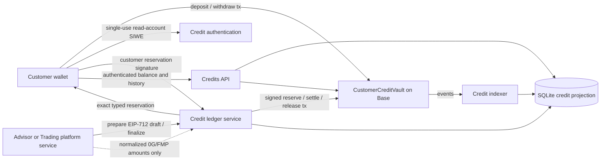
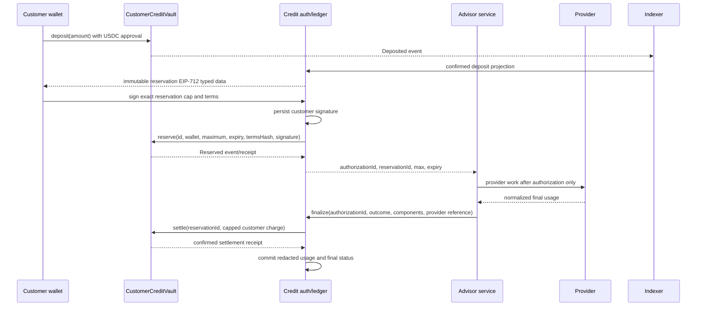
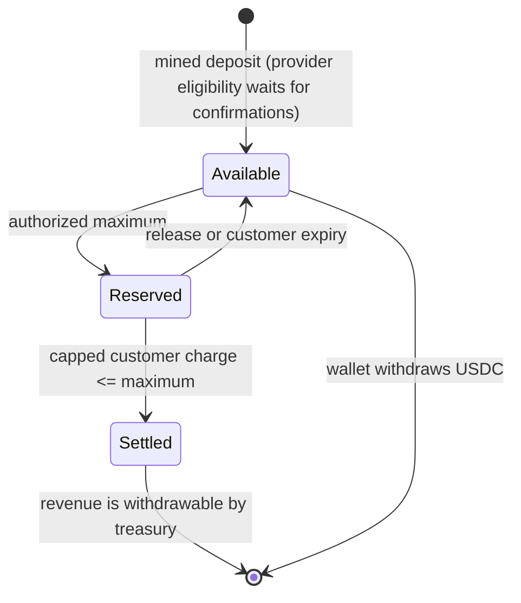
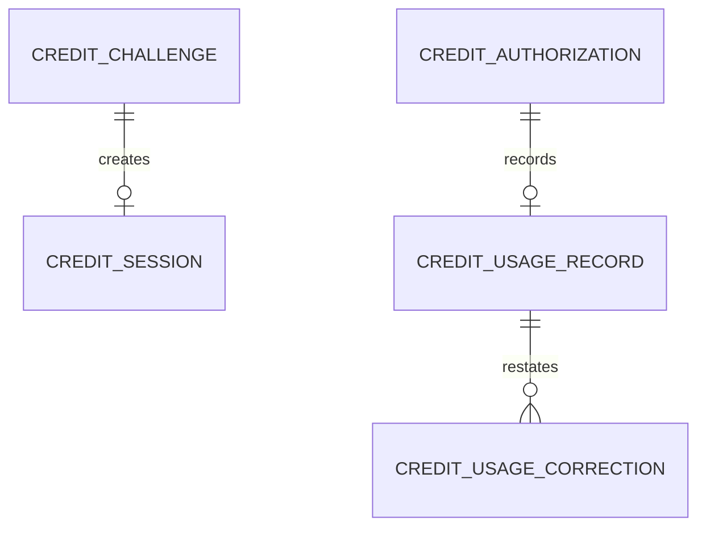

# Technical Design: Customer Credits

## Overview

Customer Credits adds a Base-native-USDC prepaid balance that a wallet holder can deposit, inspect, authorize for a disclosed maximum charge, and withdraw when unreserved. A Base vault is the monetary authority for customer available and reserved credit units. A server-side ledger records private authentication, price snapshots, usage components, and provider reconciliation; it does not custody customer funds.

The feature replaces no existing customer accounting because none exists. It deliberately leaves `AgentWallet` untouched: its owner/agent execution authority is for Leg operations, not customer funds. `value-investing-advisor` invokes the server-only authorization/finalization handoff before and after provider work. No downstream feature may write balances or access provider secrets.

### Goals

- Accept and redeem only Base mainnet native USDC, one micro-USDC unit at a time.
- Enforce available/reserved/settled credit transitions and prevent a final charge above the displayed authorization maximum.
- Make customer identity, price snapshot, usage history, and correction history durable and auditable.
- Keep 0G/FMP credentials and raw FMP data server-only.

### Non-Goals

- Multiple settlement assets or chains, credit transfers, interest, or tokenized credit shares.
- Direct customer 0G/FMP accounts, raw FMP download, provider clients, investment advice, trade execution, issuer eligibility, or World checks.
- Cross-chain credit/trade atomicity, automated top-ups, and a generic payments framework.

## Boundary Commitments

### This Spec Owns

- The `CustomerCreditVault` contract, its Base-USDC monetary invariants, and deployment/ABI integration.
- Action-bound wallet authentication for credit reads and server-side billing authorization.
- The durable credit projection: pricing snapshots, authorization state, immutable usage/correction records, chain-event indexing, and customer balance/usage views.
- The server-only `authorize` and `finalize` handoff contract used by paid Leg services.

### Out of Boundary

- 0G Compute Router and FMP request construction, raw responses, keys, and commercial contracting; the advisor feature owns those integrations and returns normalized metering only.
- Advisor chat, recommendation semantics, tokenized-stock orders/fees, and World credential verification.
- Customer trade assets and `AgentWallet` changes.

### Allowed Dependencies

- Base mainnet native USDC at `0x833589fCD6eDb6E08f4c7C32D4f71b54bdA02913`; no configurable token address in production.
- Existing Foundry 0.8.24/`forge-std`, Next.js 15, TypeScript 5.6, Node 24.11.x, viem 2.21, wagmi/RainbowKit wallet connection, encrypted-secret scripts, and generated contract ABI path.
- Prisma ORM 7.8.0 with its generated client and local SQLite adapter, using a file-backed local SQLite database on the same persistent host volume as the Node server, and one protected scheduled invocation for the indexer.
- An audited, pinned OpenZeppelin Contracts v5 release for ERC-20 transfers, roles, reentrancy protection, and pausing. Add it only after the required `ethskills` process and dependency review.

### Revalidation Triggers

- Changing the vault functions/events, Base-USDC address, credit-unit semantics, authorization input, finalization input, or error codes requires revalidation by `value-investing-advisor` and `tokenized-stock-trading`.
- Changing the account identity model, confirmation depth, authorization expiry, pricing model, provider-cost components, local SQLite storage path, or migration workflow requires revalidation by all credit consumers.
- Adding trade consideration, route fees, World status, another chain, another asset, or a client-accessible provider path is out of scope and requires a new specification.

## Architecture

### Existing Architecture Analysis

The application already connects wallets through wagmi/RainbowKit and uses viem for reads, but server routes accept client-provided addresses for public data and have no signed session or durable storage. The only contract is `AgentWallet`, whose owner or agent may call arbitrary targets. Existing encrypted secrets are decrypted into server child processes; `NEXT_PUBLIC_*` values are browser-visible.

### Architecture Pattern & Boundary Map

The selected pattern is a narrow onchain custody boundary plus a server-side projection. The vault is authoritative for funds and credit balance transitions. Its mappings and events are public blockchain data and are not treated as confidential. A file-backed local SQLite database on the same persistent Node host is authoritative only for private authentication, billing intent, usage history, and off-chain idempotency; it projects vault events and never creates, removes, or traps customer credit. The indexer binds that database durably to one chain, vault address, and deployment block before projecting an event, and fails closed if a restored database belongs to different deployment metadata. A database or indexer outage may stop new paid-provider authorizations, but it never blocks a customer-signed vault withdrawal. The server-only authorization boundary has no HTTP endpoint for arbitrary browser callers.



**Dependency direction:** generated contract types → credit types/config → database and Base clients → authentication/ledger/indexer services → API routes → credits UI. A layer may import only from layers to its left. `value-investing-advisor` imports the server-only handoff at the service layer; it may not import database, vault, or provider-secret implementation details.

### Technology Stack

| Layer | Choice / Version | Role in Feature | Notes |
|---|---|---|---|
| Smart contract | Solidity 0.8.24, Foundry, pinned OpenZeppelin Contracts v5 | Base-USDC custody and balance state | Non-upgradeable; requires `ethskills` before implementation |
| Web/client | Next.js 15, React 19, wagmi/RainbowKit | Wallet transaction and credit view | Existing stack; no private keys in browser |
| Server | TypeScript 5.6, Node 24.11.x, viem 2.21, Node `crypto` | SIWE verification, Base interactions, business rules | viem public-client verification supports EOAs and ERC-1271 accounts |
| Data | Prisma ORM 7.8.0, generated Prisma Client, file-backed local SQLite | Nonces, event projection, authorizations, usage records | Runs in the Node 24.11.x server runtime against a durable host-mounted path; startup fails closed if the local path or Prisma configuration is unavailable |
| Runtime | Existing encrypted local secrets / production Node runtime env; protected scheduled HTTP job | Provider credentials, canonical app origin, local database, and cursor advancement | `CREDIT_APP_ORIGIN` fixes the SIWE relying-party origin; `CREDIT_DATABASE_PATH` must resolve to a writable persistent volume; no `NEXT_PUBLIC_*` secret may be introduced |

## File Structure Plan

### Directory Structure

```text
packages/foundry/
├── src/CustomerCreditVault.sol            # Base-USDC available/reserved/revenue state
├── script/Deploy.s.sol                     # Deploys the vault with Base production roles
├── test/CustomerCreditVault.t.sol          # Unit and fuzz coverage for vault transitions
└── test/CustomerCreditVaultInvariant.t.sol # Stateful invariant coverage for vault liabilities

packages/nextjs/
├── prisma.config.ts                         # Server-only local SQLite datasource configuration for Prisma CLI
├── prisma/
│   ├── schema.prisma                         # Credit data model and typed-client generation
│   └── migrations/                           # Prisma-generated, forward-only migration history
├── scripts/migrate-credits.mts                 # Applies the committed Prisma migration history
├── scripts/backup-credits.mts                  # Produces a consistent local SQLite backup for host operations
├── scripts/restore-credits.mts                 # Restores a reviewed backup to an explicit local target
├── app/credits/page.tsx                    # Credit page shell
├── app/api/credits/challenge/route.ts      # Issues action-bound SIWE challenge
├── app/api/credits/session/route.ts        # Verifies one challenge and sets session
├── app/api/credits/account/route.ts        # Authenticated account, pending deposits, usage view
├── app/api/internal/credits/sync/route.ts  # Secret-protected scheduled vault-event indexer trigger
├── components/CreditsPanel.tsx             # Deposit, withdrawal, balance, and usage UI
├── contracts/deployedContracts.ts           # Generated vault ABI/deployment entry
└── lib/credits/
    ├── config.ts                            # Server-only Base, vault, local SQLite, expiry, and confirmation config
    ├── db.ts                                # Prisma client construction, migration runner, and recovery verification
    ├── auth.ts                              # SIWE challenge/session verification and consumption
    ├── vault.ts                             # Generated-ABI vault reads and event decoding
    ├── ledger.ts                            # Authorization, finalization, correction, account queries, and vault writes
    ├── indexer.ts                           # Idempotent confirmed-event projection and reorg handling
    └── generated/prisma/                    # Generated Prisma Client for the credit schema

```

### Modified Files

- `packages/foundry/foundry.toml` — add the reviewed OpenZeppelin remapping after dependency installation.
- `packages/nextjs/prisma/schema.prisma` — define the durable credit data model; Prisma generates and applies the migration history.
- `packages/nextjs/contracts/deployedContracts.ts` — generated output only; do not hand-edit deployment values.

No `AgentWallet.sol`, public chat route, provider client, or downstream-spec file is modified by this feature.

## System Flows

### Deposit, Authorization, and Settlement



The ledger persists an authorization before submitting a chain transaction and marks it active only after the receipt/event confirms it. Repeated authorization/finalization uses the same correlation and reservation IDs. A provider failure before usage releases the reservation; failure after usage settles only the normalized incurred amount. A provisional usage record keeps the full reservation; a customer may expire it after its disclosed expiry, after which Leg absorbs any later provider cost.

### Vault Credit Lifecycle



## Requirements Traceability

| Requirement | Design realization |
|---|---|
| 1.1 | Vault `deposit` and authenticated account lookup |
| 1.2 | `auth.ts` action proof and contract `msg.sender` actions |
| 1.3 | Single-use read SIWE replay binding plus EIP-712 reservation chain/vault/domain replay binding |
| 1.4 | Verified-wallet comparison at every API/service boundary |
| 1.5 | Separate `CustomerCreditVault`; no `AgentWallet` imports |
| 1.6 | Immutable Base-USDC config and UI disclosure |
| 2.1 | `Deposited` event projection with unique log key |
| 2.2 | Confirmation-depth indexer and pending-event view |
| 2.3 | Reverted calls create no event; canonical reorg removal becomes a reversed projection |
| 2.4 | Vault available/reserved reads plus pending event projection |
| 2.5 | Unique chain log and deposit transaction constraints |
| 3.1 | Immutable price draft and exact EIP-712 reservation display |
| 3.2 | Customer-signed `reserve` transition and server-only authorization result |
| 3.3 | Available-balance check before provider invocation |
| 3.4 | Off-chain and on-chain EIP-712 customer-signature verification before reservation |
| 3.5 | Correlation-ID and vault reservation-id idempotency |
| 3.6 | Provider accounts remain server-side only |
| 4.1 | `settle` moves only final charge and releases remainder |
| 4.2 | Normalized component records tied to authorization |
| 4.3 | Authenticated account API excludes provider credentials/raw data |
| 4.4 | `release` after zero-cost failure |
| 4.5 | Failed finalization settles only incurred normalized amount |
| 4.6 | Provisional record retains reservation through finalization/expiry |
| 4.7 | Append-only correction records referencing original usage |
| 5.1 | Customer-only vault `withdraw` from available balance |
| 5.2 | `withdraw` pays only `msg.sender` and emits one event |
| 5.3 | Vault amount check and explicit error mapping |
| 5.4 | Available balance decrements before transfer; pending UI status |
| 5.5 | Revert-safe transfer and idempotent event projection |
| 6.1 | Server-only normalized provider-cost finalization |
| 6.2 | Production FMP licence runtime gate before advisor authorization |
| 6.3 | Server-only secrets and redacted account/usage DTOs |
| 6.4 | Immutable authorization pricing snapshot |
| 6.5 | Reconciliation audit fields and append-only correction history |
| 7.1 | `authorize`/`finalize` advisor handoff contract |
| 7.2 | Service-type allowlist and trading-platform charge-only validation |
| 7.3 | Credit actions require credit authorization; World gets no debit API |
| 7.4 | Boundary checks exclude advice/trades/eligibility/FMP payloads |

## Components and Interfaces

| Component | Domain/Layer | Intent | Req Coverage | Key Dependencies | Contracts |
|---|---|---|---|---|---|
| CustomerCreditVault | Base contract | Custody and credit-state authority | 1.5–1.6, 2.1–2.5, 3.2–3.5, 4.1, 4.4–4.6, 5.1–5.5 | Base USDC (P0), billing signer (P0) | Service, Event, State |
| Base vault client | Server adapter | Decode generated vault events and provide typed read access | 2.1–2.5, 4.3, 5.2–5.5 | Generated vault ABI (P0), Base RPC (P0) | Service, State |
| Credit authentication | Server | Verify and consume read-account wallet proofs | 1.1–1.4 | viem Base public client (P0), local SQLite (P0) | Service, API, State |
| Credit ledger service | Server | Price, reserve, finalize, query, and handoff | 3.1–3.6, 4.1–4.7, 6.1–6.5, 7.1–7.4 | Vault (P0), local SQLite (P0), advisor (P1) | Service, State |
| Vault indexer | Server job | Confirm and project vault events | 2.1–2.5, 4.3, 5.2–5.5 | Base RPC (P0), local SQLite (P0) | Batch, State |
| Credits API and UI | API/UI | Offer authenticated customer credit experience | 1.2, 1.4, 1.6, 2.2, 2.4, 3.1, 4.3, 5.4 | Auth/ledger/vault (P0) | API, State |

### Base Contract

#### CustomerCreditVault

| Field | Detail |
|---|---|
| Intent | Hold Base native USDC and enforce customer available/reserved credit transitions. |
| Requirements | 1.5, 1.6, 2.1–2.5, 3.2–3.5, 4.1, 4.4–4.6, 5.1–5.5 |

**Responsibilities & Constraints**

- Store USDC units as `uint256` micro-USDC; never use floating-point values or a credit token.
- `deposit` transfers USDC from `msg.sender` and immediately increases that address's self-custodied on-chain available balance. `withdraw` sends unreserved USDC only to `msg.sender` after decreasing available balance; neither action depends on the server database or indexer.
- `reserve` moves at most available balance to a unique reservation only after an EOA or ERC-1271 signature validates the EIP-712 reservation ID, customer, maximum, expiry, canonical terms hash, chain ID, and vault address. `settle` accepts a final total no greater than its reservation, increases treasury revenue by that total, and returns the remainder to available. `release` or public `expire` returns the entire reservation.
- `totalCustomerLiability` equals all customer available plus reserved credits. Revenue withdrawals may not use customer liability. All mutation functions emit an event carrying its stable ID.
- The billing role alone can submit a customer-authorized reservation and can settle or release it; the role cannot choose an unsigned customer cap. A separated admin role manages the billing role and pause state. Pausing blocks new deposits/reservations, settlement, and revenue withdrawal but never customer withdrawals, releases, or expiry.
- The contract is non-upgradeable. The implementation must follow the `ethskills` guidance, use reviewed OpenZeppelin transfer/reentrancy/role primitives, receive an independent security review, and pass the specified invariant suite before Base deployment.

**Dependencies**

- Inbound: Customer wallet — deposit/withdraw/expire (P0).
- Inbound: Credit ledger billing signer — reserve/settle/release (P0).
- Outbound: Base native USDC — transfers (P0).
- External: OpenZeppelin Contracts v5 — `SafeERC20`, `AccessControl`, `Pausable`, `ReentrancyGuard` (P0).

**Contracts**: Service [x] / API [ ] / Event [x] / Batch [ ] / State [x]

##### Service Interface

```solidity
deposit(uint256 amount)
withdraw(uint256 amount)
reservationDigest(bytes32 reservationId, address customer, uint256 maximumCharge, uint48 expiresAt, bytes32 termsHash) returns (bytes32)
reserve(bytes32 reservationId, address customer, uint256 maximumCharge, uint48 expiresAt, bytes32 termsHash, bytes customerSignature)
settle(bytes32 reservationId, uint256 finalCharge)
release(bytes32 reservationId)
expire(bytes32 reservationId)
availableCreditOf(address customer) returns (uint256)
reservedCreditOf(address customer) returns (uint256)
withdrawRevenue(address recipient, uint256 amount)
```

- Preconditions: production deployment uses the fixed Base native USDC; all amounts are nonzero micro-USDC; a reservation ID is unused; expiry is in the future; `finalCharge <= maximumCharge`.
- Postconditions: every accepted mutation has exactly one event and preserves `vault USDC balance >= totalCustomerLiability + unwithdrawnRevenue`.
- Invariants: a customer cannot withdraw reserved credit; no role can withdraw customer liabilities; `AgentWallet` has no authority over this vault.

##### Event Contract

- `Deposited(customer, amount)`, `Withdrawn(customer, amount)`, `Reserved(reservationId, customer, maximumCharge, expiresAt, termsHash)`, `Settled(reservationId, finalCharge, releasedAmount)`, `Released(reservationId, reason)`, and `RevenueWithdrawn(recipient, amount)`.
- Delivery: Base logs are at-least-once to the indexer. The unique event identity is `(chainId, transactionHash, logIndex)`.

**Implementation Notes**

- Integration: a customer uses direct wallet contract calls; the server's dedicated billing signer is not a treasury or provider-key signer.
- Validation: constructor rejects zero addresses; custom errors cover unsupported transition, insufficient available credit, duplicate ID, expiry, and excessive settlement.
- Risks: token or role misconfiguration can strand or lose funds; deploy only to Base after testnet rehearsal, source verification, multisig role review, and independent audit.

### Server Domain

#### Credit Authentication

| Field | Detail |
|---|---|
| Intent | Convert a wallet signature into one consumed, action-bound verified identity. |
| Requirements | 1.1–1.4 |

**Responsibilities & Constraints**

- Issue a random, single-use SIWE challenge carrying the validated `CREDIT_APP_ORIGIN`, chain ID 8453, `read-account`, request ID, issued-at, and short expiry. Production origins require HTTPS; loopback HTTP is accepted only outside production for local rehearsal. This proof gates only Leg's private off-chain account history; it does not authorize billing or claim to hide public vault mappings or events.
- Verify parsed SIWE fields and its EOA/ERC-1271 signature through a Base viem public client; atomically mark the challenge consumed before returning a signed-in account session.
- Store only a secure, httpOnly, same-site session identifier in the browser. Persist only its one-way hash with the consumed challenge ID, wallet, `read-account` action, request ID, expiry, and optional revocation time. Sessions are wallet-bound and expire after 15 minutes; an account session never authorizes a billing action, and an invalid, expired, consumed, or revoked proof never authorizes a credit action.

**Dependencies**

- Inbound: Credits API — read-account challenge/verification request (P0).
- Outbound: local SQLite — nonce/session state (P0).
- External: viem Base public client — EOA/ERC-1271 verification (P0).

**Contracts**: Service [x] / API [x] / Event [ ] / Batch [ ] / State [x]

##### Service Interface

```typescript
type CreditAction = "read-account";

type VerifiedCreditAction = {
  challengeId: string;
  wallet: `0x${string}`;
  action: CreditAction;
  requestId: string;
  expiresAt: Date;
};

interface CreditAuthService {
  createChallenge(input: { wallet: `0x${string}`; action: CreditAction; requestId: string }): Promise<{ challengeId: string; message: string; expiresAt: Date }>;
  verifyChallenge(input: { challengeId: string; message: string; signature: `0x${string}` }): Promise<VerifiedCreditAction>;
}
```

#### Credit Ledger Service

| Field | Detail |
|---|---|
| Intent | Enforce the credit protocol around the vault and expose the only billable-service handoff. |
| Requirements | 3.1–3.6, 4.1–4.7, 6.1–6.5, 7.1–7.4 |

**Responsibilities & Constraints**

- `prepareAuthorization` creates one immutable `PENDING` draft with a random durable authorization ID, SHA-256-derived reservation ID, exact price snapshot, canonical human-readable charge purpose, and EIP-712 typed data. The typed data binds the reservation/customer/cap/expiry/terms hash to Base and this vault. The only first-release service types are `advisor` and `trading-platform`; the latter accepts a Leg platform-service component only.
- `authorize` verifies the EOA/ERC-1271 customer signature over that stored draft, persists the public signature before any broadcast, and always resumes with the first stored signature. Submit `reserve` with that signature, wait for configured confirmations, and reread the canonical reservation before returning a usable authorization.
- Accept only normalized integer micro-USDC components (`0g`, `fmp`, `legService`) and a redacted provider reference from a server-only caller. Validate component sum, matching service type, request ID, state, and expiry; retain the provider's actual component total for reconciliation while capping each customer component by its signed price and the resulting customer charge by the authorized maximum before `settle` or `release`.
- Store provisional/final/failed usage without raw provider payloads, provider secrets, or FMP content. An append-only correction links to the original record; it may restate a component or disclose a reconciliation result but cannot create a later customer debit after settlement.
- If final metering is unavailable, keep the vault reservation and mark usage provisional. Once the reservation expires, allow customer expiry/release and assign all later provider cost to Leg.

**Dependencies**

- Inbound: `value-investing-advisor` and `tokenized-stock-trading` server orchestrators (P0); Credits API account query (P1).
- Outbound: CustomerCreditVault client — reserve/settle/release (P0); local SQLite — transactions and records (P0).
- External: FMP licence configuration — production gate only (P0).

**Contracts**: Service [x] / API [ ] / Event [ ] / Batch [ ] / State [x]

##### Service Interface

```typescript
type CreditComponent = "0g" | "fmp" | "legService";
type CreditServiceType = "advisor" | "trading-platform";
type MicroUsdc = bigint;

type PriceSnapshot = {
  version: string;
  components: Readonly<Record<CreditComponent, MicroUsdc>>;
  maximumCharge: MicroUsdc;
};

type AuthorizationInput = {
  wallet: `0x${string}`;
  correlationId: string;
  serviceType: CreditServiceType;
  pricing: PriceSnapshot;
  expiresAt: Date;
};

type ReservationAuthorizationInput = {
  authorizationId: string;
  customerSignature: `0x${string}`;
};

type CompletionInput = {
  authorizationId: string;
  outcome: "succeeded" | "failed";
  components: Readonly<Record<CreditComponent, MicroUsdc>> | null;
  providerReference: string | null;
};

interface CreditLedgerService {
  prepareAuthorization(input: AuthorizationInput): Promise<{ authorizationId: string; reservationId: `0x${string}`; expiresAt: Date; chargePurpose: string; typedData: object }>;
  authorize(input: ReservationAuthorizationInput): Promise<{ authorizationId: string; reservationId: `0x${string}`; expiresAt: Date }>;
  finalize(input: CompletionInput): Promise<{ status: "settled" | "released" | "provisional" | "failed" | "expired" }>;
}
```

- The interface is server-only. `value-investing-advisor` supplies all three component amounts. `tokenized-stock-trading` supplies zero for `0g` and `fmp` and may supply only its disclosed `legService` amount. `world-trade-credential` receives no ledger interface.
- Money is `bigint` in server code and a validated base-10 string in JSON/SQL boundaries. No `number`, `any`, or type assertion represents money or a wallet identity.

#### Vault Indexer

| Field | Detail |
|---|---|
| Intent | Project confirmed Base vault logs into customer-visible deposit/withdrawal state. |
| Requirements | 2.1–2.5, 4.3, 5.2–5.5 |

**Responsibilities & Constraints**

- Advance one serialized cursor under a short database transaction; fetch vault logs outside that transaction in bounded, contiguous block ranges from the last confirmed block through the current head.
- Insert each event once using `(chain_id, transaction_hash, log_index)` uniqueness. Retain block hash with each row and rewind unfinalized rows on a detected reorganization.
- Keep mined deposits pending for paid-provider authorization until `CREDIT_CONFIRMATIONS` confirmations. Before authorization, index through a chosen Base head and read the vault at that same block so a deposit cannot become spendable merely because it landed between scheduled indexer runs. A pending deposit remains part of the wallet's live, self-withdrawable on-chain available balance, so authorization preflight subtracts all pending deposits through that snapshot head from the raw vault available amount. This environment value is a production calibration knob; start conservatively and revise only from observed Base reliability.
- Expose only projected event status and public amount/account facts. The scheduled endpoint accepts only its runtime secret and performs no customer action.

**Dependencies**

- Inbound: protected schedule (P0).
- Inbound: Base vault client — typed vault events and reads (P0).
- Outbound: local SQLite cursor/event tables (P0).
- External: Base RPC via viem (P0).

**Contracts**: Service [ ] / API [x] / Event [ ] / Batch [x] / State [x]

### API and UI

#### Credits API and UI

| Field | Detail |
|---|---|
| Intent | Let an authenticated wallet inspect credits and perform direct vault transactions. |
| Requirements | 1.2, 1.4, 1.6, 2.2, 2.4, 3.1, 4.3, 5.4 |

**Responsibilities & Constraints**

- The API issues/verifies read-only SIWE challenges and returns only the verified wallet's combined account view, pending deposits, reservation status, and redacted usage/correction history. Public on-chain balances may be read independently from Base, but Leg's private customer history and billing state are never returned for an unverified posted address.
- The credit-account UI displays Base USDC, available/reserved/pending amounts, transaction state, and actionable rejected/error status. A consuming downstream UI displays the canonical correlation ID, price version, components, maximum, and reservation expiry before requesting the exact EIP-712 reservation signature; this feature deliberately exposes no browser endpoint that can invent provider amounts.
- Deposit and withdrawal use wallet `approve`/`deposit` and `withdraw` contract calls; the UI never sends a private key, provider credential, raw FMP result, or treasury operation.

**Contracts**: Service [ ] / API [x] / Event [ ] / Batch [ ] / State [x]

##### API Contract

| Method | Endpoint | Request | Response | Errors |
|---|---|---|---|---|
| POST | `/api/credits/challenge` | wallet, `read-account`, requestId | SIWE message, expiry | 400, 403, 429 |
| POST | `/api/credits/session` | signed SIWE message | httpOnly session, verified wallet/action | 401, 403, 429 |
| DELETE | `/api/credits/session` | same-origin request with session cookie | revoked session and expired cookie | 204, 403, 503 |
| GET | `/api/credits/account` | authenticated session | balances, pending deposits, usage/corrections | 401, 503 |
| POST | `/api/internal/credits/sync` | scheduler credential | cursor/result summary | 401, 503 |

No browser endpoint accepts a provider amount or calls `authorize`/`finalize` directly.

## Data Models

### Domain Model

- **Credit account**: an on-chain wallet address with public available/reserved Base-USDC units plus private Leg billing history. The vault is the financial authority; wallet proof is required for Leg's private combined view.
- **Authorization**: one immutable draft plus customer EIP-712 reservation signature, price snapshot, maximum, Base reservation ID, expiry, and service type. Its random server ID identifies the draft and its separate correlation ID is the idempotency key.
- **Usage record**: append-only private metering result for an authorization. It is `provisional`, `settled`, `released`, or `failed`; a correction references an original usage record and never authorizes a new debit.
- **Chain event**: a durable observed vault funding log whose finality may move from pending to confirmed or reversed during canonical-chain reconciliation.



### Logical Data Model

| Table | Keys / constraints | Purpose |
|---|---|---|
| `credit_challenges` | `id` PK, `nonce` unique, `message_hash`, `wallet`, `action`, reusable `request_id`, `expires_at`, `consumed_at`, `created_at` | Exact-message-bound, single-use SIWE action proof; a fresh challenge may replace an expired unsigned proof for the same request |
| `credit_sessions` | `id` PK, `secret_hash` unique, `challenge_id` unique, `wallet`, `action`, `request_id`, `expires_at`, `revoked_at` | Short-lived read-account session; raw cookie secret is never stored |
| `credit_authorizations` | `id` PK, nullable legacy `challenge_id`, `correlation_id` unique, `reservation_id` unique, nullable validated `reservation_signature`, `wallet`, `service_type`, `charge_purpose`, price snapshot, max, expiry, status/rejection, vault transaction hash and timestamps | Immutable billing draft, persisted EIP-712 intent, and idempotency |
| `credit_usage_records` | `id` PK, `authorization_id` unique, status, three numeric provider-cost component columns, provider total, capped customer charge, provider reference hash | Redacted provisional/final usage without making provider cost itself a customer debit |
| `credit_usage_corrections` | `id` PK, `usage_record_id`, reason, component restatement, created time | Append-only reconciliation history |
| `credit_chain_events` | unique `(chain_id, transaction_hash, log_index)`, block number/hash, event, wallet, amount, finality | Confirmed/pending Base projection |
| `credit_indexer_state` | singleton chain ID, vault address, deployment block, cursor, block hash, updated time | Crash-safe serialized indexer position and durable deployment binding |

- Credit amount columns use SQLite `INTEGER`; validation rejects a negative value or one above `9_223_372_036_854_775_807` micro-USDC before persistence, and JSON uses decimal strings.
- Prisma Client state transitions run in one database transaction. The vault transaction hash/receipt is stored before a state is shown as reserved, settled, or released.
- The credit Prisma Client rejects update, delete, and upsert operations for usage corrections, so reconciliation history is append-only.
- Database values are a projection and private audit record; a vault read is the source for live available/reserved credit. Paid-provider authorization uses the live vault available value minus any indexed deposits still below the confirmation threshold. Customer withdrawal uses the vault alone.

## Error Handling

| Category | Condition | Customer / caller response | Recovery |
|---|---|---|---|
| Authentication | Missing, expired, malformed, replayed, or wrong-wallet proof | 401/403 with sign-again guidance | Issue a new single-use challenge |
| Funding | Reverted deposit call, unconfirmed event, or reorganization | Wallet transaction failure, pending event, or reversed event status | Correct the call, wait for finality, or submit supported Base-USDC deposit |
| Authorization | Insufficient available credit, duplicate ID, expired action, missing FMP licence | No provider request starts; explanatory 409/422 | Top up, refresh authorization, or enable verified licence |
| Provider | Failure before/after usage or delayed metering | Usage shows released, settled failed, or provisional | Release/settle exact amount; expire then Leg bears late cost |
| Withdrawal | Insufficient available balance or reverted USDC transfer | Wallet transaction error and unchanged credit | Retry after state resolves; no server payout retry |
| Runtime | Missing/unwritable or wrong-deployment local database, RPC, or indexer outage | 503; no new authorization | Restore the matching host volume or dependency, then retry; vault self-withdraw remains available |

The server logs correlation/reservation IDs, transaction hashes, status, and redacted provider reference hashes. It must never log signatures, session values, provider keys, raw FMP payloads, or customer prompt content.

## Testing Strategy

### Smart Contract Tests

- Verify deposit, reserve, settle, release, expire, and withdrawal transitions preserve customer-liability and revenue invariants.
- Fuzz arbitrary valid operation sequences and assert a wallet never withdraws more than available, settlement never exceeds the reservation, and vault USDC covers customer liability plus unwithdrawn revenue.
- Verify duplicate reservation IDs, wrong roles, zero/unsupported values, expired settlement, pause behavior, and reentrant token transfer attempts revert without accounting change.
- Verify `withdraw` always pays the calling wallet and that no `AgentWallet` address/role grants custody control.

### Server and Integration Tests

- Verify valid EOA and ERC-1271 read-only SIWE proofs and EIP-712 reservation signatures; reject wrong origin/chain/action, vault, cap, terms, expiry, nonce replay, and mismatched wallet before provider work.
- Verify duplicate correlation/finalization calls remain idempotent, insufficient funds invoke no provider callback, and a provisional charge retains its reservation until finalization or expiry.
- Verify FMP licence gating and that every account/usage DTO omits provider credentials and raw FMP data.
- Simulate duplicate logs, confirmation delay, reorg rewind, and cursor restart; assert one projected deposit/withdrawal and correct pending status.

### Critical Customer Flows

- Connect wallet, sign the private account-view action, approve/deposit Base USDC, observe that the mined deposit is self-withdrawable immediately but remains in the pending-for-provider amount until confirmed.
- View a disclosed advisor price, sign one exact EIP-712 reservation, complete success/failure, and inspect componentized usage plus released balance.
- Withdraw only unreserved credits to the same wallet while a reservation remains unavailable.

## Security Considerations

- Treat the billing signer and all provider credentials as production secrets. Provider runtime variables must be encrypted locally and server-only in production; `NEXT_PUBLIC_*` is prohibited.
- Use HTTPS, httpOnly secure same-site session cookies, rate-limit challenge issuance, validate exact SIWE fields, and use atomic nonce consumption.
- Separate vault admin, billing, and treasury duties across reviewed operational accounts; production admin is a multisig. The contract is non-upgradeable and must complete audit/rehearsal/verification before holding production funds.
- Financial operations are fail-closed: database/RPC/auth failure prevents new provider work; it does not create an unbounded debit, a manual server withdrawal path, or a dependency between local infrastructure and the customer's direct vault withdrawal.

## Operational Prerequisites and Rollout

1. Complete the required `ethskills` process and contract security review; pin dependency versions and deploy/verify to Base Sepolia for rehearsal.
2. Provision a canonical `CREDIT_APP_ORIGIN`, a persistent host-local path for `CREDIT_DATABASE_PATH`, Base RPC, billing signer, treasury/admin multisig values, `CREDIT_CONFIRMATIONS`, and a scheduler secret. Pin the server to Node 24.11.x, review and apply the committed Prisma migration history on that host, and rehearse backup/restore before enabling the runtime. The credit routes run only in the Node runtime; store FMP/0G keys only in server runtime secrets.
3. Confirm FMP commercial rights for the paid customer-facing use and set the production licence gate only after documented approval.
4. Deploy the Base vault, generate ABI/deployment data, run the indexer from deployment block, and validate a deposit/authorization/settlement/withdrawal rehearsal before enabling provider-backed charges.

## Design Review Gate

Design review passed: all requirement IDs 1.1–7.4 map to explicit components and contracts; the vault/server/downstream boundary is concrete; every named component has a file path; and the implementation sequence exposes its Prisma-managed local SQLite storage, recovery, security, and runtime prerequisites.
