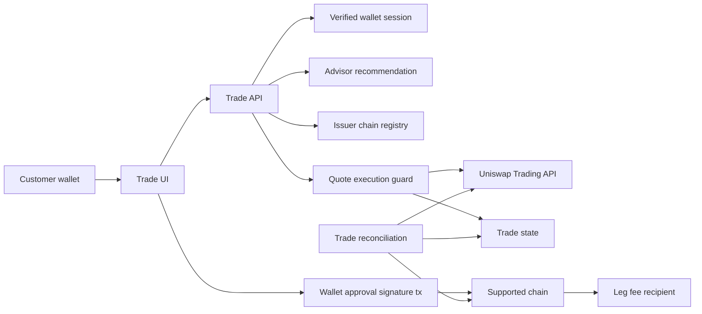
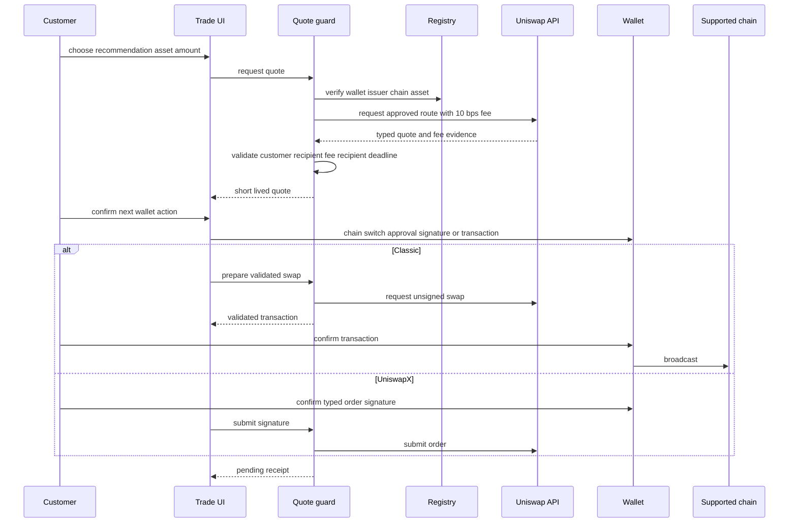
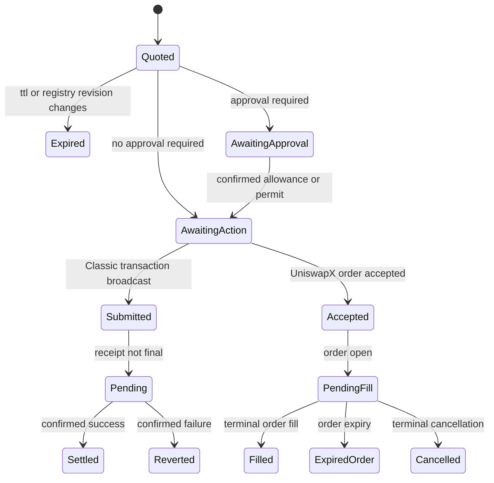
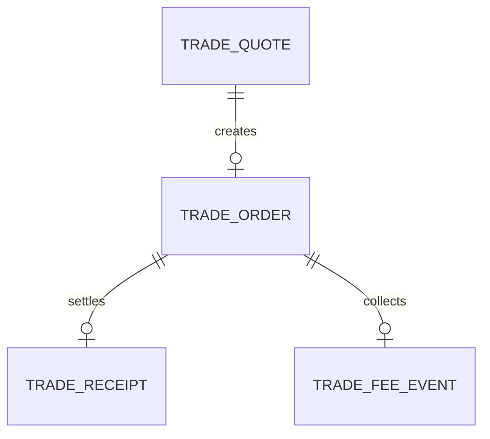

# Technical Design: Tokenized-Stock Trading

## Overview

Tokenized-Stock Trading turns a valid, wallet-bound advisor recommendation into a customer-confirmed trade of an issuer-approved asset on one configured EVM chain. The server owns issuer eligibility, quote policy, Uniswap credentials, typed route validation, the fixed 10 bps integrator-fee configuration, and status persistence. The customer wallet remains the sole signer and recipient of trade proceeds.

Every eligible quote uses Uniswap Trading API's current request-scoped integrator-fee structure. The fee is 10 bps of the swap output and is sent directly by the resulting route to `LegIntegratorFeeRecipient`, a configured recipient address. A quote is unavailable if it cannot prove that exact fee. There is no v4 hook, fee-receiver contract, withdrawal flow, or Customer Credits trade charge.

### Goals

- Execute only issuer-eligible, recommendation-bound, same-chain trades after an explicit customer confirmation for every wallet action.
- Make Classic and UniswapX routes typed, customer-recipient-bound, short-lived, and independently reconcilable.
- Request, disclose, validate, and evidence exactly one 10 bps API-native integrator fee without custody of either trade assets or fees.
- Keep credits, advice, and World gating as adjacent boundaries rather than absorbing them into trade execution.

### Non-Goals

- Automatic trading, saved approval execution, custody, arbitrary recipient transfers, cross-chain plans or bridges, or a claim of universal tokenized-stock availability.
- Issuer KYC, accreditation, suitability, legal, tax, or jurisdiction decisions.
- Custom Uniswap hooks, fee contracts, fee withdrawals, fee tiers, a Customer Credits debit or reservation, and a World credential implementation.

## Boundary Commitments

### This Spec Owns

- The issuer-and-chain asset registry, recommendation-to-trade validation, quote policy, Uniswap API gateway, order persistence, reconciliation, receipts, and trading UI.
- The fixed 10 bps API integrator-fee configuration, direct recipient validation, customer fee disclosure, and terminal fee evidence.

### Out of Boundary

- Customer Credits balances, reservations, debits, settlement, credit history, provider metering, and any conversion of credits to swap funds or trade fees.
- Advisor research, recommendation generation, asset valuation, issuer KYC/accreditation, FMP/0G access, and World verification.
- `AgentWallet`, customer private keys, third-party recipients, fee custody, fee withdrawal, custom v4 hooks, and deployment operations.

### Allowed Dependencies

- Customer Credits' `CreditAuthService` `read-account` identity action, consumed through a server-side adapter as a short-lived verified wallet identity only; its ledger, vault, `authorize`, and `finalize` interfaces are forbidden dependencies.
- The Advisor recommendation store's read-only `ValueInvestingRecommendation.v1` handoff, consumed through a server-side adapter that validates the exact wallet and expiry before a quote is created.
- Existing Next.js 15, TypeScript 5.6, Zod, viem 2.21, wagmi/RainbowKit, and the shared file-backed local SQLite runtime established by Customer Credits: Node's built-in `node:sqlite` on the same persistent Node server host at `CREDIT_DATABASE_PATH`.
- A server-only Uniswap Trading API key, its current OpenAPI document, supported-chain deployment data, and a configured RPC for each approved issuer chain.

### Revalidation Triggers

- Changing the recommendation handoff, verified-wallet identity, asset issuer conditions, chain, token address, customer recipient model, fee recipient, or 10 bps fee policy invalidates open quotes and requires trade-spec revalidation.
- Changing the API fee schema, quote/action validation, route types, receipt status, or direct fee evidence requires end-to-end revalidation.
- Adding credits to the trade flow, a hook, a fee contract, a bridge, recurring trade, automated trade, third-party recipient, World gate, or fee tier requires a reviewed new specification or amendment.

## Architecture

### Existing Architecture Analysis

The scaffold has RainbowKit/wagmi configuration, viem-based reads, a working explicit `useSwitchChain` pattern, and a simple Foundry contract. It has no authenticated trading session, durable order state, Trading API client, or customer transaction flow. `AgentWallet` is intentionally excluded because its agent authority is incompatible with customer asset control.

Customer Credits owns `CreditAuthService`; Trading consumes only its `read-account` action as a verified wallet identity. The Advisor owns `ValueInvestingRecommendation.v1`; Trading reads it through the Advisor recommendation handoff. Neither upstream capability receives quote calldata, token approvals, trade receipts, or fee state. Trading does not invoke Customer Credits for authorization, metering, reservation, debit, or finalization.

### Architecture Pattern and Boundary Map

The selected pattern is a server-side quote guard with direct customer-wallet execution. It is smaller than a trade executor contract and preserves the hard boundary: the server prepares a validated action; only the wallet broadcasts or signs it.



**Dependency direction:** trading types/config/registry → Uniswap and chain clients plus repository → quote/execution guard and reconciliation → API routes → trade UI. UI code never imports a server secret, repository, or unvalidated API response. No component depends on Customer Credits or a fee contract.

### Technology Stack

| Layer | Choice / Version | Role in Feature | Notes |
|---|---|---|---|
| Web | Next.js 15, React 19, wagmi/RainbowKit | Customer confirmation, chain switch, receipt UI | Reuses configured wallets; each action is user initiated |
| Server | TypeScript 5.6, Zod, Node `fetch`, viem 2.21 | Eligibility, typed quote guard, status reconciliation | API key and RPC configuration are server-only |
| Data | Node `node:sqlite` with the file-backed `CREDIT_DATABASE_PATH` database | Quote, execution, fee, and receipt audit state | Trade-owned tables use committed forward-only migrations and host-local backup/restore on the same persistent Node server host; they never write credit tables |
| External | Uniswap Trading API | Quotes, Classic unsigned actions, UniswapX order/status | Current OAS fixture is part of validation |

## File Structure Plan

### Directory Structure

```text
packages/nextjs/
├── app/trade/page.tsx                                # Trade page shell
├── app/api/trades/assets/route.ts                    # Authenticated eligible asset list
├── app/api/trades/quotes/route.ts                    # Recommendation-bound quote creation
├── app/api/trades/quotes/[quoteId]/prepare/route.ts  # Validated Classic or UniswapX action preparation
├── app/api/trades/orders/[orderId]/submitted/route.ts # Customer action submission acknowledgement
├── app/api/trades/orders/[orderId]/route.ts          # Authenticated order status and receipt lookup
├── app/api/internal/trades/reconcile/route.ts        # Secret-protected status reconciliation
├── components/trading/TradePanel.tsx                 # Asset, quote, wallet-action, and receipt states
└── lib/trading/
    ├── types.ts                                      # Registry, quote, route, fee, receipt, and error contracts
    ├── config.ts                                     # Server-only API key, RPC, fee recipient, and TTL configuration
    ├── registry.ts                                   # Reviewed issuer, chain, and token eligibility entries
    ├── upstream.ts                                   # Verified wallet and immutable recommendation handoff adapters
    ├── uniswap.ts                                    # Typed Trading API request, response parsing, and status client
    ├── migrations.ts                                 # Committed forward-only SQL migrations for trade-owned tables
    ├── repository.ts                                 # Quote, order, fee-evidence, and receipt persistence
    ├── guard.ts                                      # Recommendation, wallet, route, recipient, expiry, and fee checks
    └── orchestrator.ts                               # Quote, prepare, submission, and reconciliation workflow

```

### Modified Files

- `packages/nextjs/lib/wagmi-config.ts` — adds only registry-configured supported issuer chains and transports.
- `packages/nextjs/components/Header.tsx` — exposes the Trade route.

No Customer Credits, Advisor, World, Graph client, `AgentWallet`, Foundry configuration, contract deployment file, or provider-secret file is modified by this feature.

## System Flows

### Quote and Customer-confirmed Execution



Every wallet request is issued only after fresh quote validation. Classic transactions are never submitted by the server. UniswapX is shown as accepted or pending until its provider and chain status become terminal.

### Order Status Lifecycle



The reconciler is idempotent. A terminal record carries exactly one API integrator-fee evidence record and one receipt; changing issuer registry revision or quote expiry never refreshes or broadcasts an existing action.

## Requirements Traceability

| Requirement | Summary | Components | Interfaces | Flows |
|---|---|---|---|---|
| 1.1, 1.2, 1.3 | Recommendation-bound intent | Trade guard, Trade API | Quote input | Quote execution |
| 2.1, 2.2, 2.3, 2.4 | Issuer and chain eligibility | Registry, Trade guard, Trade UI | Eligible asset response | Quote execution |
| 3.1, 3.2, 3.3, 3.4, 3.5 | Current quote and API fee | Uniswap gateway, Trade guard, Trade UI | Typed quote and fee | Quote execution |
| 4.1, 4.2, 4.3, 4.4 | Server-validated typed route | Uniswap gateway, Trade guard | Classic and UniswapX unions | Quote execution |
| 5.1, 5.2, 5.3, 5.4 | Wallet-only execution | Trade UI, Trade API | Wallet action response | Quote execution |
| 6.1, 6.2, 6.3, 6.4 | Terminal outcome and receipt | Reconciler, repository, Trade UI | Receipt response | Order lifecycle |
| 7.1, 7.2, 7.3, 7.4 | Direct fee recipient and evidence | Uniswap gateway, guard, repository | Fee evidence | Quote execution and lifecycle |
| 8.1, 8.2 | Credits excluded from trading | Trade guard, Trade API, Trade UI | Trade response | All flows |
| 9.1, 9.2, 9.3, 9.4 | Fail-closed operation and validation | Guard, gateway, repository, tests | Error envelope | All flows |

## Components and Interfaces

| Component | Domain | Intent | Requirements | Key Dependencies | Contracts |
|---|---|---|---|---|---|
| Trade registry | Server config | Define approved issuer-chain-token entries | 1.1, 1.2, 2.1, 2.2, 2.3, 2.4 | Runtime config (P0) | Service, State |
| Upstream handoff adapters | Server integration | Read the verified wallet and immutable recommendation | 1.1, 1.2, 1.3, 8.1, 9.1, 9.2 | CreditAuthService and Advisor store (P0) | Service |
| Uniswap gateway | Server integration | Request and parse approved routes and one fee | 3.1, 3.3, 3.4, 3.5, 4.1, 4.2, 4.3, 4.4, 7.1, 7.3, 9.1, 9.2, 9.3 | Trading API (P0) | Service |
| Trade guard and orchestrator | Server domain | Enforce one safe quote-to-action state machine | 1.1, 1.2, 1.3, 3.2, 4.1, 4.2, 7.1, 7.4, 8.1, 8.2, 9.1, 9.2 | Registry, advisor, repository (P0) | Service, State |
| Trade repository and reconciler | Server/data | Persist truthful trade, fee evidence, and receipt lifecycle | 6.1, 6.2, 6.3, 6.4, 7.2, 7.3, 8.1, 8.2, 9.1, 9.2 | Local SQLite, RPC, Trading API (P0) | Service, API, Batch, State |
| Trade API and panel | API/UI | Obtain customer confirmation and show disclosures and receipt | 2.1, 2.2, 3.1, 3.2, 3.3, 5.1, 5.2, 5.3, 5.4, 6.3, 8.2 | Trade guard, wagmi (P0) | API, State |

### Server Domain

#### Upstream Handoff Adapters

| Field | Detail |
|---|---|
| Intent | Read the two upstream facts needed for trade intent without importing credit accounting or recommendation creation. |
| Requirements | 1.1, 1.2, 1.3, 8.1, 9.1, 9.2 |

**Responsibilities and Constraints**

- `VerifiedWalletSession` is implemented by an adapter over Customer Credits' `CreditAuthService`. It accepts only an unexpired `VerifiedCreditAction` where `action` is `read-account`; it returns the action wallet as the authenticated customer identity. It never accepts `authorize-advisor` or `authorize-trading-platform` as a trade identity and never calls the credit ledger.
- `AdvisorRecommendationReader` is implemented by an adapter over the Advisor recommendation store. It returns only the exact immutable `ValueInvestingRecommendation.v1` for the authenticated wallet, validates version and expiry, and rejects a missing, malformed, expired, or cross-wallet artifact.
- The adapters are the only allowed Trading imports from Customer Credits and Advisor. They return no credit balance, reservation, provider data, free-form chat text, order, signature, route, or eligibility assertion.

**Dependencies**

- External: Customer Credits `CreditAuthService` — `read-account` verified action (P0).
- External: Advisor recommendation store — immutable recommendation handoff (P0).

**Contracts**: Service [x] / API [ ] / Event [ ] / Batch [ ] / State [ ]

```typescript
type Address = `0x${string}`;

type TradingWalletIdentity = {
  wallet: Address;
  action: "read-account";
  requestId: string;
  expiresAt: Date;
};

type ValueInvestingRecommendationV1 = {
  id: string;
  version: "ValueInvestingRecommendation.v1";
  wallet: Address;
  assetReference: string;
  stance: "buy" | "sell" | "hold";
  thesis: string;
  evidenceReferences: readonly string[];
  calculationReferences: readonly string[];
  risks: readonly string[];
  generatedAt: Date;
  expiresAt: Date;
};

interface VerifiedWalletSession {
  requireReadAccountIdentity(): Promise<TradingWalletIdentity>;
}

interface AdvisorRecommendationReader {
  readForWallet(input: { recommendationId: string; wallet: Address }): Promise<ValueInvestingRecommendationV1>;
}
```

Preconditions: the Customer Credits action is signature-verified, has action `read-account`, and is unexpired; the recommendation is exactly `ValueInvestingRecommendation.v1`, wallet-bound, and unexpired. Postconditions: Trade Guard receives one address and one immutable recommendation artifact. Invariants: a wallet identity is never a credit authorization, and an advisor recommendation never establishes issuer eligibility, route, fee, price, or trading permission.

**Implementation Notes**

- Integration: adapters map upstream errors to an unavailable trade-intent result; upstream persistence and APIs remain owned by their source specs.
- Validation: validation is repeated at the adapter boundary and before quote persistence; no posted wallet or recommendation content becomes authority.
- Risks: a changed upstream action or recommendation contract requires a Trading revalidation before release.

#### Trade Registry

| Field | Detail |
|---|---|
| Intent | Make issuer and chain approval explicit before a quote exists. |
| Requirements | 1.1, 1.2, 2.1, 2.2, 2.3, 2.4 |

**Responsibilities and Constraints**

- Stores reviewed configuration only: issuer ID and version, chain ID, token address and decimals, permitted input assets, eligibility mode, required issuer condition, enabled flag, registry revision, and approved route destinations.
- The first release enables only entries whose issuer condition can be established without pretending to perform KYC or accreditation. Entries requiring a missing issuer flow are unavailable.
- Resolves the selected recommendation asset to exactly one active registry entry. A changed revision invalidates every nonterminal quote for that entry.

**Dependencies**

- Inbound: Trade guard — asset lookup (P0).
- External: server runtime configuration — reviewed entries (P0).

**Contracts**: Service [x] / API [ ] / Event [ ] / Batch [ ] / State [x]

```typescript
type EligibilityMode = "public" | "issuer-step-required";

type EligibleAsset = {
  issuerId: string;
  registryRevision: string;
  chainId: number;
  token: Address;
  decimals: number;
  eligibility: EligibilityMode;
};
```

**Implementation Notes**

- Integration: chain, address, decimal, issuer condition, and allowed destination values are parsed at server startup; invalid configuration disables the entry.
- Risks: registry configuration is a controlled availability list, not an issuer eligibility oracle. A non-public condition has no bypass path.

#### Uniswap Gateway and Trade Guard

| Field | Detail |
|---|---|
| Intent | Convert a permitted quote request into one persisted, typed, customer-recipient-safe action with one verified API fee. |
| Requirements | 3.1, 3.2, 3.3, 3.4, 3.5, 4.1, 4.2, 4.3, 4.4, 7.1, 7.3, 7.4, 8.1, 8.2, 9.1, 9.2, 9.3 |

**Responsibilities and Constraints**

- Obtains `TradingWalletIdentity` through `VerifiedWalletSession` and the exact `ValueInvestingRecommendationV1` through `AdvisorRecommendationReader`; requires their wallet, recommendation expiry, asset reference, and stance to match the request.
- Builds a same-chain request with only registry-approved tokens and protocols. It sets the output recipient to the authenticated wallet and the OAS-defined integrator-fee recipient to `LegIntegratorFeeRecipient` at exactly 10 bps. It rejects bridges, chained routes, unsupported route kinds, and unapproved token, router, reactor, customer recipient, deadline, input amount, or execution destination.
- Parses the current OAS response into Classic and UniswapX discriminated unions. It validates that the returned fee evidence is an output-token 10 bps fee to the configured recipient and persists immutable fee fields with the canonical request hash and registry revision.
- Derives `expiresAt` as the earlier of the provider deadline and `now + 30 seconds`. Classic preparation obtains a new unsigned action only while the stored quote is fresh. UniswapX preparation validates the typed order payload and accepts its signature only for that fresh stored order.
- Never reads, authorizes, reserves, debits, finalizes, or displays Customer Credits.

**Dependencies**

- Inbound: Trade API — quote and prepare requests (P0).
- Outbound: Registry — approved asset and destination facts (P0); repository — idempotent persistence (P0); upstream handoff adapters — identity and recommendation (P0).
- External: Uniswap Trading API — quote, approval, swap, order, and status calls (P0).

**Contracts**: Service [x] / API [ ] / Event [ ] / Batch [ ] / State [x]

```typescript
type DecimalAmount = string;

type IntegratorFee = {
  bps: 10;
  token: Address;
  amount: DecimalAmount;
  recipient: Address;
};

type ValidatedTransaction = {
  to: Address;
  from: Address;
  data: `0x${string}`;
  value: DecimalAmount;
  chainId: number;
};

type ClassicQuote = {
  kind: "classic";
  quoteId: string;
  transaction: ValidatedTransaction;
  minimumOutput: DecimalAmount;
  fee: IntegratorFee;
};

type UniswapXQuote = {
  kind: "uniswapx";
  quoteId: string;
  orderId: string;
  chainId: number;
  deadline: Date;
  inputToken: Address;
  inputMaximum: DecimalAmount;
  outputToken: Address;
  outputMinimum: DecimalAmount;
  recipient: Address;
  fee: IntegratorFee;
};

type ValidatedTradeQuote = ClassicQuote | UniswapXQuote;
```

Preconditions: a verified wallet, matching unexpired recommendation, enabled registry entry, parsed amount, and available server configuration. Postconditions: a quote names exactly one route kind, the customer recipient, and one verified 10 bps fee. Invariants: no client-supplied calldata or signature changes a stored quote; `fee` cannot transition after quote creation; money remains a validated base-10 string at JSON and SQL boundaries and `bigint` in calculations.

**Implementation Notes**

- Integration: API requests are server-side because browser calls would expose the API key and bypass validation.
- Validation: no `any`, `unknown`, or unsafe assertion is used to decode route data; each response branch is runtime-parsed into its declared union.
- Risks: a payload that cannot prove the required fee is unavailable rather than retried without a fee or diverted to a custom collector.

#### Trade Repository and Reconciler

| Field | Detail |
|---|---|
| Intent | Keep one durable, wallet-scoped source for quote, order, fee-evidence, and receipt state. |
| Requirements | 6.1, 6.2, 6.3, 6.4, 7.2, 7.3, 8.1, 8.2, 9.1, 9.2 |

**Responsibilities and Constraints**

- Creates a quote once per client idempotency key and canonical input hash. Claims an order once per quote/action and accepts a submitted Classic transaction hash or UniswapX order ID only for its owner wallet.
- Reconciles Classic transaction receipts through the configured RPC and UniswapX order status through the official status endpoint. It never resubmits an action, signs on behalf of a customer, or treats acceptance as fill.
- Creates a receipt only from terminal evidence. It records one fee event only when terminal evidence matches the stored token, amount, recipient, chain, and transaction or order reference.
- The protected job serializes its cursor, tolerates duplicate status reads, and leaves a truthful pending status on an outage.

**Dependencies**

- Inbound: Trade guard and protected reconciler route (P0).
- Outbound: local SQLite — atomic order, fee, and receipt transitions (P0).
- External: chain RPC and Uniswap status endpoints (P0).

**Contracts**: Service [x] / API [x] / Event [ ] / Batch [x] / State [x]

##### API Contract

| Method | Endpoint | Request | Response | Errors |
|---|---|---|---|---|
| GET | `/api/trades/assets` | verified session, chain | eligible assets and unavailable reasons | 401, 403, 422, 503 |
| POST | `/api/trades/quotes` | recommendation ID, asset, direction, exact amount, slippage | disclosed `ValidatedTradeQuote`, fee, expiry | 400, 401, 403, 409, 422, 503 |
| POST | `/api/trades/quotes/[quoteId]/prepare` | verified session, action kind | one validated approval, Classic action, or UniswapX signing request | 401, 403, 409, 422, 503 |
| POST | `/api/trades/orders/[orderId]/submitted` | wallet-confirmed Classic hash or UniswapX signature result | pending order state | 400, 401, 403, 409, 422, 503 |
| GET | `/api/trades/orders/[orderId]` | verified session | wallet-scoped status and terminal receipt | 401, 403, 404, 503 |
| POST | `/api/internal/trades/reconcile` | scheduler secret | cursor and reconciled count | 401, 409, 503 |

### API and UI

#### Trade API and Panel

| Field | Detail |
|---|---|
| Intent | Present only server-validated choices and ask the wallet for each action. |
| Requirements | 2.1, 2.2, 3.1, 3.2, 3.3, 5.1, 5.2, 5.3, 5.4, 6.3, 8.2 |

**Responsibilities and Constraints**

- Shows registry-approved assets, unavailable reasons, recommendation disclaimer, quote amounts, fee amount/token/recipient, expiry, route kind, and action-specific transaction/signature summary.
- Reuses the existing explicit wagmi chain-switch pattern before every approval, Classic transaction, or UniswapX signature. It obtains a chain-specific wallet client at action time and waits for a Classic receipt.
- Requests each approval, permit, Classic transaction, and UniswapX typed order only from a direct customer click. Rejection, timeout, disconnect, or chain mismatch produces a non-executed state; no retry submits an action.
- Polls the wallet-scoped order endpoint for pending status and renders a receipt only after terminal evidence. It never displays a credit balance or trade-credit charge.

**Contracts**: Service [ ] / API [x] / Event [ ] / Batch [ ] / State [x]

## Data Models

### Domain Model

- **Asset entry**: versioned issuer-chain-token configuration with enabled eligibility conditions.
- **Trade quote**: one wallet/recommendation/registry revision/input/customer-recipient/fee/expiry snapshot. It is immutable after creation except status.
- **Trade order**: the customer-facing execution reference created from one quote. It is Classic or UniswapX, never both.
- **Fee event**: exactly one proven 10 bps integrator-fee output for a terminal order.
- **Receipt**: a wallet-scoped terminal view derived from confirmed chain or UniswapX evidence.



### Logical Data Model

| Table | Key constraints | Purpose |
|---|---|---|
| `trade_quotes` | ID PK, wallet, recommendation ID, registry revision, request hash unique per active attempt, expiry, route kind, fee bps/token/amount/recipient | immutable validated quote state |
| `trade_orders` | ID PK, quote ID unique, wallet, kind, provider order ID/tx hash unique when present, status | wallet-scoped action and terminal lifecycle |
| `trade_receipts` | order ID unique, terminal status, confirmed amounts, chain reference | durable truthful receipt |
| `trade_fee_events` | order ID unique, token, amount, recipient, chain reference | one API-fee audit record |
| `trade_reconcile_state` | singleton cursor/lease/version | idempotent protected reconciliation |

- EVM token amounts use validated canonical base-10 `TEXT` because SQLite `INTEGER` cannot represent all `uint256` values; JSON uses the same canonical strings. Addresses are normalized and validated at every boundary.
- Local SQLite transitions for quote claim, submission acknowledgement, terminal receipt, and fee event occur in one database transaction. The database is evidence/projection; a final Classic receipt remains authoritative for chain outcome.
- A unique order-fee record constrains each terminal order to at most one Leg fee record. There is no fee-mode, withdrawal, credit, or hook state.

## Error Handling

| Category | Condition | Response | Recovery |
|---|---|---|---|
| Identity | Missing or wrong-wallet session or recommendation | 401/403; no quote/action | Re-authenticate with the same wallet |
| Eligibility | Disabled issuer, chain, token, or condition | 422 unavailable reason | Choose a supported asset or complete issuer-required step outside Leg |
| Quote | Expired, changed registry, no route, unsafe payload, or unproven fee | 409/422; no wallet action | Request a fresh quote |
| Wallet | Rejected approval/signature/transaction or wrong chain | Non-executed status | Reconnect/switch and explicitly retry |
| Execution | Classic revert or UniswapX terminal failure | Terminal receipt with truthful reference | Fresh explicit trade only |
| Fee | Recipient, amount, token, or evidence mismatch | Reject or retain pending; no fee record | Correct configuration or investigate |
| Runtime | API/RPC/database outage | 503 for new work; pending remains pending | Reconcile after recovery without resubmission |

Operational logs retain correlation ID, quote/order ID, route kind, fee token/amount/recipient, status, and transaction/order reference. They never retain API keys, wallet signatures, client-provided raw route payloads, customer research content, or credit balances. Observed Uniswap bugs and workarounds are recorded as redacted evidence in `feedbacks/uniswap.md`; no speculative feedback is written.

## Testing Strategy

### Server and UI Tests

- Validate recommendation wallet, expiry, and asset binding; registry revision invalidation; issuer-disabled rejection; and the absence of a quote/action in every unavailable branch.
- Use current official OAS fixtures to parse Classic and UniswapX routes. Reject a changed token, customer recipient, fee recipient, fee token, fee amount, chain, deadline, empty calldata, unapproved router/reactor, chained route, or unknown response shape.
- Test every eligible quote requests and discloses exactly one 10 bps integrator fee to `LegIntegratorFeeRecipient`; test that missing or mismatched fee evidence cannot reach a wallet action or terminal fee record.
- Test every approval, permit, Classic transaction, and UniswapX order requires a distinct click, chain switch, and rejection-safe UI state. Test Classic receipt confirmation and UniswapX accepted, open, filled, expired, cancelled, and failed states.
- Test submission/reconciliation idempotency, duplicate provider status reads, RPC/API outage pending state, wrong-wallet receipt denial, and the absence of Customer Credits reads or writes in every trade path.

## Security Considerations

- Treat the Uniswap API key, RPC credentials, scheduler secret, and fee-recipient configuration authority as server/operator secrets. No `NEXT_PUBLIC_*` value contains a secret.
- Fail closed before every new customer wallet request on identity, recommendation, registry, route, API, chain, persistence, fee configuration, or fee-validation failure.
- Server validation is repeated at quote creation and action preparation. Browser values are display requests, never authority for recipient, token, chain, amount, route, or fee.
- The direct fee recipient has no trading authority. The server cannot substitute a client-provided recipient, remove the fee, or replace it with a credit or hook charge.

## Operational Prerequisites and Rollout

1. Complete the verified-session and Advisor recommendation handoff validation. Provision the persistent host-local `CREDIT_DATABASE_PATH`, allowed-chain RPCs, Uniswap API key, reviewed issuer registry, direct fee-recipient addresses, and quote/reconciliation runtime values. Apply the committed forward-only trade migration with Node's built-in `node:sqlite`, then rehearse local backup/restore before customer traffic.
2. Verify the current Uniswap OAS fee schema, supported chain/router deployments, Classic and UniswapX fixtures, and customer-recipient/fee-recipient rejection in a non-production environment. Record only observed integration findings.
3. Rehearse one Classic route, one UniswapX route where supported, quote expiry, fee mismatch rejection, failed wallet action, direct fee evidence, and terminal receipt before exposing an issuer-chain entry to customers.

## Design Review Gate

Design review passed: all requirement IDs 1.1–9.4 map to concrete boundaries, components, state, and tests; the direct API fee, customer wallet authority, and credit exclusion have explicit non-overlapping seams; every component has a file plan; and the quote, fee, recipient, expiry, and reconciliation prerequisites are executable without an unresolved design gap.
