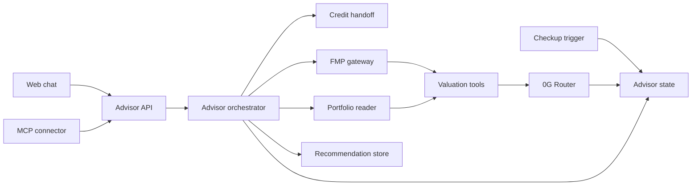
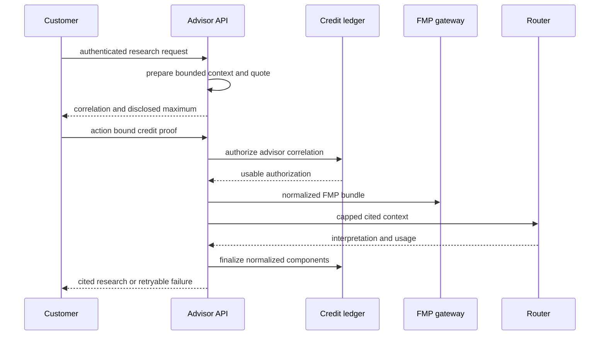
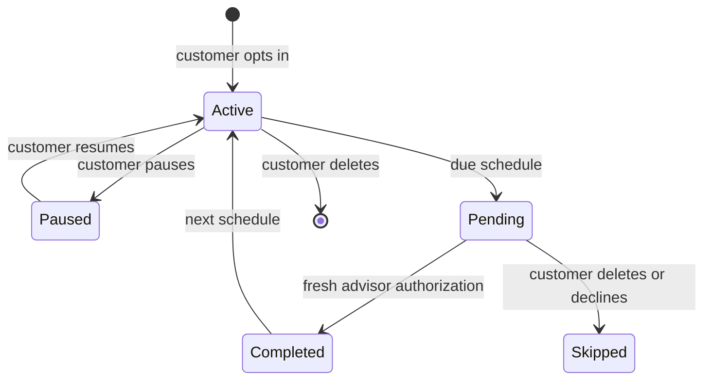

# Technical Design: Value-Investing Advisor

## Overview

Value-Investing Advisor replaces the scaffold's generic Gemini chat with wallet-aware, cited investment research. One server-side advisor orchestration path serves web chat, the authenticated MCP connector, and customer-authorized portfolio checkups. It applies a versioned Markdown philosophy, calls the Leg-owned 0G Router, obtains normalized FMP facts, evaluates fixed deterministic formulas, and returns bounded research rather than advice, custody, or a trade.

### Goals

- Deliver explainable research grounded in the published philosophy version and cited normalized facts.
- Obtain a Customer Credits advisor authorization before every FMP or 0G request, then finalize only normalized `0g`, `fmp`, and `legService` micro-USDC usage.
- Make deterministic valuations, selected wallet reads, checkups, and `ValueInvestingRecommendation.v1` available through one server-side path.
- Give ChatGPT and Claude a common Streamable HTTP MCP connector without creating a second billing or research implementation.

### Non-Goals

- Credit balances, ledger transitions, FMP account administration, raw FMP export, provider-account sharing, trading, issuer eligibility, route selection, World verification, custody, or suitability advice.
- A second model provider, model fallback, generic calculation language, recurring debit, downloadable portfolio data, or vendor-specific connector.

## Boundary Commitments

### This Spec Owns

- Published philosophy content, advisor quotes/runs, normalized research records, valuations, selected supported-token reads, checkup state, recommendation artifacts, and the web/MCP transports.
- Server-side 0G Router and FMP gateway use, including price/context bounds, source metadata, redacted operational events, and the progressive 0G feedback log.
- The exact adapter to the upstream server-only Customer Credits authorization and finalization handoff.

### Out of Boundary

- `CustomerCreditVault`, credit authentication persistence, credit prices/reservations/usage records, and direct access to credit database or vault modules.
- Any tokenized-stock order, quote, eligibility assertion, route, fee, signature, submission, confirmation, or execution.
- Any FMP credential/raw payload return or storage, private-key/approval request for portfolio reads, and legal, tax, custody, or suitability decision.

### Allowed Dependencies

- Upstream `CreditAuthService`, `VerifiedCreditAction`, and `CreditLedgerService` server-only contracts, using `serviceType: "advisor"` only.
- Existing Next.js 15, TypeScript 5.6, viem 2.21, wagmi/RainbowKit, Zod, encrypted-secret runtime, and `ai` UI primitives.
- One pinned direct `@modelcontextprotocol/sdk` dependency for Streamable HTTP MCP/OAuth; the Node Pages API adapter is used only where its Node request/response transport is required.
- 0G Router and FMP stable APIs from server runtime secrets, and the shared file-backed local SQLite runtime established by Customer Credits: Node's built-in `node:sqlite` on the same persistent Node server host at `CREDIT_DATABASE_PATH`.

### Revalidation Triggers

- A change to the credit handoff, correlation binding, component schema, quote maximum, or authorization expiry requires revalidation with Customer Credits.
- A change to `ValueInvestingRecommendation.v1` requires revalidation with tokenized-stock trading.
- Adding another model/provider, formula, data-display entitlement, connector protocol, unattended paid checkup, chain/token mapping, or automated trade requires a new specification or a reviewed amendment.

## Architecture

### Existing Architecture Analysis

The scaffold has an accessible `useChat` page, wagmi wallet connection, a Gemini `/api/chat` route, and public balance reads. None is a verified advisor identity or provider boundary. Customer Credits supplies the future action-bound wallet proof and the only reservation/finalization interface; the advisor imports that service boundary but not its persistence or vault internals.

### Architecture Pattern & Boundary Map

The selected pattern is one narrow orchestrator with pure valuation functions. Browser and MCP transports only authenticate and create/continue an advisor run. The orchestrator prepares a bounded context, obtains the upstream authorization, calls providers, persists permitted derived artifacts, and finalizes metering exactly once.



**Dependency direction:** advisor types/config/content -> persistence and provider adapters -> pure portfolio/valuation functions -> orchestrator -> web/MCP/checkup routes -> UI. Each layer imports only leftward dependencies. The credit adapter is consumed only by the orchestrator.

### Technology Stack

| Layer | Choice / Version | Role | Notes |
|---|---|---|---|
| Web | Next.js 15, React 19, `ai`, wagmi/RainbowKit | Authenticated chat, quote confirmation, checkup controls | Reuses the current page/provider. |
| Server | TypeScript 5.6, Zod, Node `fetch` | Validation, orchestration, provider adapters | No `any`, unsafe assertion, or client secret. |
| Data | Node `node:sqlite` with the file-backed `CREDIT_DATABASE_PATH` database | Advisor run, citation, calculation, checkup, connector, and recommendation state | Advisor-owned tables use committed forward-only migrations and host-local backup/restore on the same persistent Node server host; advisor code never writes credit tables. |
| Chain | viem 2.21 | Authenticated selected ERC-20 balance reads | Read-only; no signing or approvals. |
| Provider | 0G Compute Router, FMP stable API | Inference and normalized facts | Router key and FMP key are server-only. |
| Connector | `@modelcontextprotocol/sdk` | Streamable HTTP MCP with OAuth 2.1/PKCE | One shared ChatGPT/Claude transport. |

## File Structure Plan

```text
packages/nextjs/
├── app/page.tsx                                      # Advisor chat shell replacing generic chat copy
├── app/api/advisor/quote/route.ts                    # Authenticated quote and credit-action preparation
├── app/api/advisor/run/route.ts                      # Authorized web research execution
├── app/api/advisor/checkups/route.ts                 # Authenticated checkup CRUD and inspection
├── app/api/internal/advisor/checkups/sync/route.ts   # Secret-protected pending-checkup creation
├── app/.well-known/oauth-authorization-server/route.ts # Connector authorization metadata
├── app/.well-known/oauth-protected-resource/route.ts # MCP resource metadata
├── pages/api/mcp.ts                                  # Node Streamable HTTP MCP transport
├── scripts/run-advisor-checkups.mts                   # Protected same-host creation of unbilled pending checkups
├── components/advisor/AdvisorChat.tsx                # Research, quote, result, and limitation states
├── components/advisor/CheckupPanel.tsx               # Selected holdings and opt-in checkup controls
├── content/advisor-philosophy/v1.md                  # Versioned seven-investor philosophy and boundary language
├── lib/advisor/
│   ├── types.ts                                      # Exact advisor, citation, calculation, and recommendation contracts
│   ├── config.ts                                     # Server-only provider, pricing, freshness, and context-bound configuration
│   ├── philosophy.ts                                 # Versioned Markdown loading and principle references
│   ├── fmp.ts                                        # Private, normalized FMP bundles
│   ├── router.ts                                     # 0G Router request, caps, response usage validation
│   ├── valuation.ts                                  # Pure, versioned deterministic formulas
│   ├── portfolio.ts                                  # Selected supported-asset read and mapping result
│   ├── migrations.ts                                 # Committed forward-only SQL migrations for advisor-owned tables
│   ├── repository.ts                                 # Advisor/checkup/citation/calculation/recommendation persistence
│   ├── orchestrator.ts                               # Quote, authorization, provider execution, and finalization path
│   ├── connector.ts                                  # MCP tools and OAuth wallet-session binding
│   └── feedback.ts                                   # Redacted progressive 0G feedback append helper
├── lib/credits/ledger.ts                             # Upstream server-only handoff import, added by Customer Credits
└── package.json                                      # Pins MCP SDK; removes Gemini SDK only after advisor replacement

feedbacks/0g.md                                       # Progressive integration findings only when observed
```

### Modified Files

- `packages/nextjs/app/page.tsx` and `packages/nextjs/app/api/chat/route.ts` — replace generic Gemini chat with the bounded advisor web path; no Gemini fallback remains.
- `packages/nextjs/package.json` and lockfile — pin the direct MCP SDK and remove an unused Google SDK only once no import remains.
- `packages/nextjs/scripts/run-advisor-checkups.mts` — run only the protected, unbilled checkup scan on the persistent Node host.

## System Flows

### Quoted Advisor Research



The quote counts the philosophy, validated conversation, selected-holding slots, bounded normalized tool-result slots, and configured completion allowance. The run recomputes the prepared-context hash after the credit action; a changed or over-budget request requires a fresh quote. A provider call never starts before authorization, and no context is silently dropped after pricing.

### Checkup Lifecycle



The scheduled path creates a unique pending record only. It does not call FMP, 0G, or Customer Credits and cannot debit a customer.

## Requirements Traceability

| Requirement | Summary | Components | Interfaces | Flows |
|---|---|---|---|---|
| 1.1, 1.2, 1.3 | Versioned philosophy and research boundary | Philosophy, orchestrator, web/MCP | Research result | Quoted research |
| 2.1, 2.2, 2.3, 2.4, 2.5 | Quote, action-bound preflight, and exact completion | Orchestrator, credit adapter | Quote and credit handoff | Quoted research |
| 3.1, 3.2, 3.3, 3.4 | Cited, limited, retryable advice | FMP gateway, valuation, Router, orchestrator | Research result | Quoted research |
| 4.1, 4.2, 4.3 | Private FMP access | Config, FMP gateway | Normalized fact bundle | Quoted research |
| 5.1, 5.2, 5.3, 5.4 | Reproducible valuation results | Valuation, repository | Calculation result | Quoted research |
| 6.1, 6.2, 6.3, 6.4 | Selected, read-only wallet holdings | Portfolio reader, web/MCP | Holding observation | Quoted research |
| 7.1, 7.2, 7.3, 7.4 | Opt-in, unbilled checkup scheduling | Checkup API/job, orchestrator | Checkup state | Checkup lifecycle |
| 8.1, 8.2, 8.3, 8.4 | Shared authenticated web and connector surfaces | Advisor API, MCP connector | MCP tool/API | Quoted research |
| 9.1, 9.2, 9.3, 9.4 | Validated downstream research artifact | Recommendation store, advisor API | Recommendation handoff | Quoted research |
| 10.1, 10.2, 10.3 | Redacted feedback and fail-closed operation | Feedback helper, config, orchestrator | Operational event | Quoted research |

## Components and Interfaces

| Component | Domain | Intent | Requirements | Key Dependencies | Contracts |
|---|---|---|---|---|---|
| Philosophy | Content | Publish a versioned research framework | 1.1, 1.2, 1.3 | Markdown content (P0) | Service |
| Advisor orchestrator | Server | Run the one authorized research path | 2.1-2.5, 3.1-3.4, 10.2-10.3 | Credits, FMP, Router (P0) | Service, State |
| FMP gateway | Server | Private normalized financial facts | 3.1-3.3, 4.1-4.3 | FMP/runtime config (P0) | Service |
| Valuation tools | Domain | Stable formula results or unavailable states | 3.1, 5.1-5.4 | FMP bundle (P0) | Service |
| Portfolio reader | Server | Read only selected wallet holdings | 6.1-6.4 | viem, asset mapping (P0) | Service |
| Checkup service | Server/job | Persist opt-in and create unbilled pending work | 7.1-7.4 | Advisor repository (P0) | API, Batch, State |
| MCP connector | Transport | OAuth-bound shared client access | 8.1-8.4 | MCP SDK, Credit Auth (P0) | API, State |
| Recommendation store | Server | Preserve wallet-bound expiring research handoff | 9.1-9.4 | Advisor repository (P0) | Service, State |

### Advisor Orchestrator

**Responsibilities & Constraints**

- Build a quote from the exact configured philosophy version, validated conversation, selected-asset descriptors, bounded tool-result capacity, Router price caps, completion allowance, FMP component, and Leg-service component. Prices are integer micro-USDC values.
- Bind the quote to one wallet, correlation ID, context hash, model/configuration versions, and expiry. A run accepts only the matching `VerifiedCreditAction`, then calls `CreditLedgerService.authorize` with `serviceType: "advisor"` before any paid provider call.
- Invoke FMP, portfolio read, deterministic calculations, and one pinned Router model. The response distinguishes source facts, calculation results, generated interpretation, and limitations; it cites philosophy principle/version where relevant.
- Finalize exactly once with normalized `0g`, `fmp`, and `legService` components. A failure with incurred usage finalizes only that amount; a pre-provider rejection finalizes zero components to release the reservation. The advisor never changes a credit balance directly.

```typescript
type AdvisorQuote = {
  correlationId: string;
  wallet: `0x${string}`;
  contextHash: string;
  expiresAt: Date;
  pricing: PriceSnapshot;
  philosophyVersion: string;
};

type AdvisorRunResult =
  | { kind: "completed"; runId: string; response: CitedResearch; recommendation?: ValueInvestingRecommendation }
  | { kind: "failed"; correlationId: string; code: "authorization" | "source" | "provider" | "context"; retryable: boolean };

interface AdvisorOrchestrator {
  quote(input: AdvisorRequest): Promise<AdvisorQuote>;
  run(input: { quote: AdvisorQuote; action: VerifiedCreditAction; request: AdvisorRequest }): Promise<AdvisorRunResult>;
}
```

Preconditions: the wallet session is verified, the correlation is fresh, FMP server configuration is available, and all incoming fields parse through Zod. Postconditions: every attempt has one terminal/admissible provisional credit outcome and never exposes a secret/raw payload. Invariant: a recommendation can only derive from the completed run that owns its wallet and citations.

### FMP Gateway and Valuation Tools

The FMP gateway reads the encrypted key at server runtime before a production request. It fetches only the bundle needed for the selected method, passes the key by header, normalizes facts with symbol, source period/observation time, and retrieval time, and never returns/persists raw payloads. Missing, stale, or ambiguous facts produce an explicit unavailable result.

Valuation remains pure and versioned: `GrahamNumber.v1`, `MarginOfSafety.v1`, `OwnerEarnings.v1`, `GreenblattEarningsYield.v1`, and `ReturnOnCapital.v1`. Inputs use validated decimal/fixed-point representations; a zero/non-positive denominator, missing value, inconsistency, or failed freshness rule returns `unavailable`, not a substitute. Stored calculation references contain method/formula version, normalized inputs, periods, result or unavailable reason, and source references.

### Portfolio Reader

The reader accepts a supported chain/token selected by the authenticated wallet, calls `balanceOf` with viem, and returns a `HoldingObservation` with chain, token, amount, read time, and either its configured research mapping or `unvalued`. An unsupported/read-failed/unmapped asset is shown as unavailable/unvalued. The reader neither infers issuer eligibility/ticker/price from token metadata nor requests a private key, transfer approval, or custody permission.

### Checkup Service

`create`, `update`, `pause`, and `delete` are authenticated wallet-scoped operations that expose selected holdings, cadence, and state. The protected scheduler creates one pending record per subscription/due instant under a unique constraint. Completing a pending checkup passes its selected assets into the same quote/authorize/run path; pausing, deletion, expiry, or decline invokes no paid provider.

### MCP Connector

One public Streamable HTTP MCP endpoint runs through the SDK's Node adapter. OAuth 2.1/PKCE, dynamic registration, redirect/client-metadata validation, bearer verification, expiry/revocation, protected-resource metadata, host/origin validation, and rate limiting protect connector sessions. OAuth browser authorization binds the token to the Customer Credits `read-account` proof and wallet; a bearer token is not a debit authorization.

Tools are limited to `quote_advisor_research`, `run_advisor_research`, `read_portfolio`, `manage_checkups`, and `get_recommendation`. A billable tool returns a quote-specific browser action URL until the customer completes `authorize-advisor`; then it invokes the same orchestrator. All other capabilities return bounded errors without secrets, raw data, cross-wallet access, or trading execution.

### Recommendation Store

`ValueInvestingRecommendation.v1` stores a stable ID, wallet, asset reference, stance, thesis, cited evidence, calculation references, risks, generated time, and expiry. Retrieval/handoff validates version, shape, expiry, and wallet before returning the exact immutable artifact. It constructs no order and includes an explicit disclaimer that it proves neither eligibility, route, price, nor trading permission.

## Data Models

Advisor persistence is separate from Customer Credits and stores no raw prompt, signature, provider key, or raw FMP response.

| Table | Key constraints | Purpose |
|---|---|---|
| `advisor_quotes` | `correlation_id` unique, wallet, context hash, expiry, quoted components | Replay-safe quote binding without prompt storage |
| `advisor_runs` | `correlation_id` unique, wallet, source, status, model/version metadata | Redacted attempt and outcome state |
| `advisor_citations` | run ID, source, symbol, period/observation, retrieved time | Response evidence metadata |
| `advisor_calculations` | stable calculation ID, run ID, formula version | Reproducible result or unavailable reason |
| `advisor_recommendations` | stable ID, run ID, wallet, expiry, version | Exact downstream artifact |
| `advisor_checkups` | wallet, subscription ID, due time unique, state | Customer-visible opt-in/pending/completed state |
| `advisor_checkup_assets` | checkup/subscription ID and chain/token | Selected assets only |
| `advisor_oauth_clients` / `advisor_oauth_tokens` | client metadata / token hash, wallet, scope, expiry/revocation | Connector authorization without bearer-token persistence |

All wallet keys are normalized addresses. Money crosses the credit boundary as validated base-10 strings/`bigint`; provider-derived decimals retain an explicit scale and source metadata. State transitions that claim a quote, create a pending checkup, consume a connector authorization, or save an artifact occur in one transaction.

## Error Handling

| Category | Condition | Response | Recovery |
|---|---|---|---|
| Identity | Missing/expired/wrong-wallet session or action | 401/403, reauthorize | Complete the matching wallet action |
| Credit | Declined/expired/mismatched quote | Actionable credit state; no provider call | Requote or top up/reauthorize |
| Data | FMP source stale/missing | Capability unavailable; no protected detail | Retry fresh source |
| Calculation | Invalid formula precondition | Named method unavailable | Select a supported method/asset |
| Provider | Router/FMP failure or invalid Router result | Failed/retryable state; exact incurred finalization | Retry fresh authorization when needed |
| Connector | Invalid bearer/client/host/scope | OAuth/MCP bounded error | Reauthorize connector |
| Runtime | DB/RPC/provider outage | 503; no new paid work | Preserve existing quote/checkup state and retry |

Operational logs retain correlation ID, outcome, normalized usage summary, and redacted diagnostic context only. An observed 0G bug, undocumented behaviour, or workaround appends symptom, redacted reproduction, impact, workaround, and resolution state to `feedbacks/0g.md`; no speculative entry is created.

## Testing Strategy

- Unit-test every named formula's valid and unavailable inputs, formula-version stability, and preserved calculation reference.
- Test the quote context hash/budget, full-context price cap, credit rejection, exact one-time finalization, zero-cost provider preflight failure, and incurred-cost failure.
- Test FMP availability/freshness/redaction behaviour, Router invalid response/usage behaviour, and provider calls blocked until authorization.
- Test supported/unmapped/unsupported/read-failed holdings and confirm no write/approval/private-key path exists.
- Test checkup uniqueness, pause/delete/decline no-provider paths, and completed checkups through the shared orchestrator.
- Test web and MCP semantic parity plus OAuth PKCE, expiry/revocation, cross-wallet access, invalid callback/host, and connector capability boundaries.
- Test recommendation shape, wallet binding, expiry, exact handoff, and no trade/eligibility claims.

## Security Considerations

- All FMP/0G credentials, OAuth signing material, and scheduler secret are server-only encrypted runtime values; no `NEXT_PUBLIC_*` value carries a secret.
- Validate every API/MCP field and wallet identity at the server boundary. Do not treat a posted address, bearer token, or chat content as a credit authorization.
- Fail closed for new paid work on auth, database, provider, or configuration failure. Preserve credit/checkup state for retry.
- Rate-limit challenge/connector entry points, hash stored OAuth tokens, restrict redirects and hosts, and redact telemetry/logs as described above.

## Operational Prerequisites and Rollout

1. Complete Customer Credits persistent-host setup and its server-only handoff tests; provision the host-local `CREDIT_DATABASE_PATH`, apply the committed forward-only advisor migration with Node's built-in `node:sqlite`, rehearse local backup/restore, and provision the 0G Router model/key/price caps, FMP encrypted key, Base RPC, and connector OAuth material.
2. Verify the selected 0G Router model, response usage semantics, FMP request/data availability, and ChatGPT/Claude OAuth/MCP connection in a non-production environment before customer traffic.
3. Enable the protected checkup scanner only after an end-to-end test confirms it creates pending records and cannot invoke paid work.
4. Replace generic chat only after quote/authorization/failure states and redaction tests pass. Record genuine 0G findings progressively in `feedbacks/0g.md`.

## Design Review Gate

Design review passed: all requirement IDs 1.1-10.3 map to concrete boundaries, contracts, state, and tests; credit, provider, connector, and trading ownership do not overlap; the file plan names each component; and the ordered implementation can expose configuration, persistence, authorization, provider, transport, and validation prerequisites without an unresolved requirements gap.
