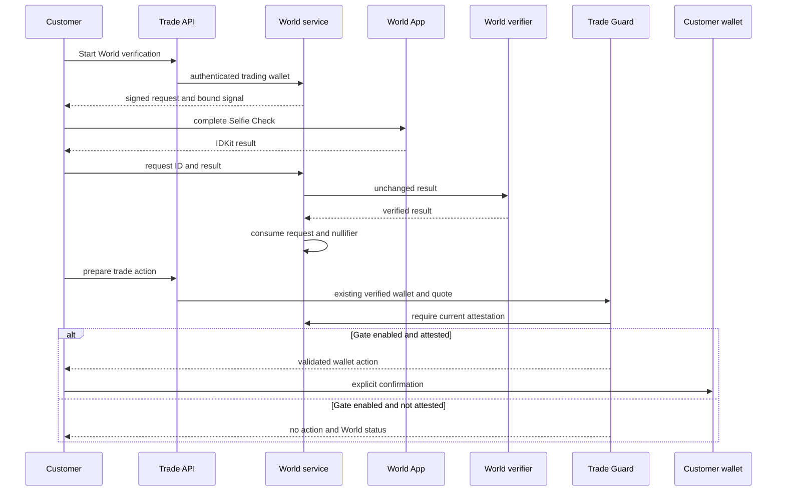
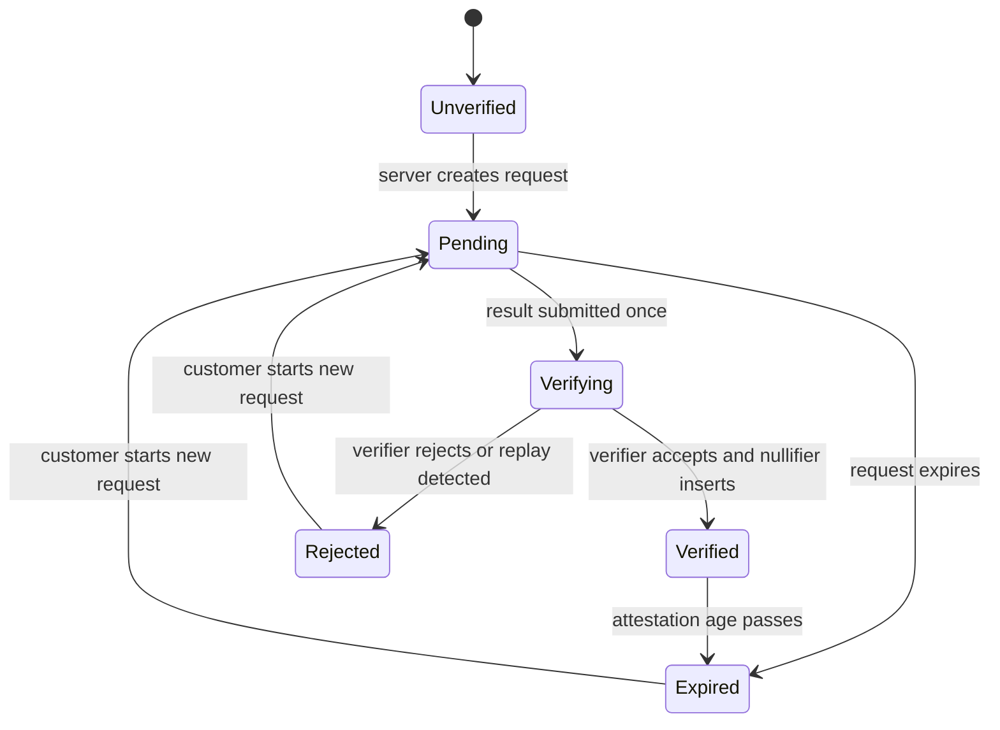
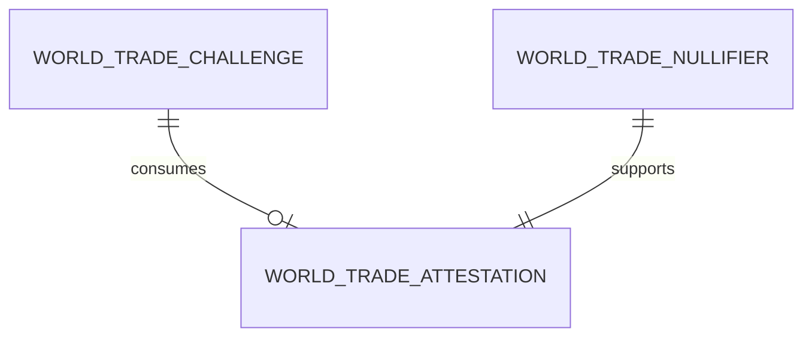

# Technical Design: World Trade Credential

## Overview

World Trade Credential adds an optional World Selfie Check, Credential 11, signal to Leg's existing controlled trade experience. A customer who already has the Customer Credits/Trading verified wallet context can start a World request, complete it in World App, and receive a server-verified attestation bound to that same wallet. When the operator enables the gate, the existing trade action-preparation path requires the attestation before it returns a wallet approval, transaction, or order-signature request.

The current official compatibility path uses IDKit 4.x with `selfieCheckLegacy` and a World ID 3.0 Face proof, verified through World’s v4 API. The feature deliberately adopts that path rather than building camera, biometric, proof, or on-chain verification logic. It stores only a normalized used-nullifier record and minimal wallet attestation; it never receives images, video, face templates, raw biometric scores, or a durable raw proof payload.

### Goals

- Bind a single World request and successful result to the wallet authenticated by the existing Leg Trading flow.
- Server-verify the unmodified World result, atomically prevent nullifier replay, and expose an understandable credential state.
- Fail closed only when the optional World gate is enabled and Leg is about to prepare a controlled wallet action.
- Keep the integration truthful: Selfie Check is a liveness/Sybil signal, not regulatory or issuer eligibility, and does not block direct Uniswap use.

### Non-Goals

- A second wallet login, SIWE flow, browser-trusted address, World sign-in/session product, custom camera, or biometric store.
- KYC, AML, sanctions, accreditation, suitability, jurisdiction, issuer eligibility, or government-document verification.
- A trade executor contract, World proof verification on-chain, modifications to Uniswap routing/fees, customer custody, or blocking third-party Uniswap interfaces.
- Invite-code/deferred-install flow, because the standard IDKit request widget already provides the required mobile deep-link and desktop QR experience.

## Boundary Commitments

### This Spec Owns

- The Credential 11 proof-request lifecycle, server-side World verification, one-time challenge/nullifier state, wallet attestation, status API, and customer verification panel.
- The `WORLD_TRADE_GATE_ENABLED` policy check added to the existing controlled Leg Trading action-preparation path.
- Redacted documentation of actual World integration issues in `feedbacks/world.md`.

### Out of Boundary

- Wallet authentication/session issuance, Customer Credits balances/debits, recommendations, issuer conditions, quote/action validation, fee collection, customer transaction submission, and order reconciliation.
- Any direct Uniswap interface, chain-level restriction, World biometric processing, raw World proof retention, and all compliance or suitability determinations.
- Changes to `AgentWallet`, Foundry contracts, Uniswap API integration, World action provisioning, or production deployment operations.

### Allowed Dependencies

- Customer Credits’ existing server-verified wallet session as consumed by Tokenized-Stock Trading. This feature receives the authenticated wallet from that context and creates no alternative identity authority.
- Tokenized-Stock Trading’s `Trade API`, `Trade Guard`, and `orchestrator` for the sole controlled action-preparation check.
- The file-backed local SQLite runtime and migration sequence established by Customer Credits and Trading: Node's built-in `node:sqlite` on the same persistent Node server host at `CREDIT_DATABASE_PATH`.
- The official `@worldcoin/idkit` 4.x React package, its server-only signing subpath, the World Developer Portal v4 verify endpoint, and the configured World Developer Portal application/RP/action.
- Existing Next.js 15, TypeScript 5.6, Zod, `tsx`, and encrypted server-secret workflow.

### Revalidation Triggers

- Changing the upstream verified-wallet context, Trading prepare endpoint, quote expiry/action lifecycle, or its wallet-action contract requires World-gate integration revalidation.
- Changing World action, RP ID, app ID, environment, SDK major version, credential constraint, signal-commitment method, verification result shape, or attestation-age policy requires World verification and replay tests to be re-run.
- Adding a credit charge, issuer claim, direct-Uniswap restriction, on-chain verifier, additional credential, or biometric retention is out of boundary and requires a new specification.

## Architecture

### Existing Architecture Analysis

The current scaffold has a browser wallet connection but no World SDK or server identity. Customer Credits introduces the authoritative server-verified wallet session; Trading reuses it in its API and `Trade Guard`, and prepares direct customer wallet actions rather than executing swaps itself. Trading's file plan already separates `guard.ts` and `orchestrator.ts`, providing the one controlled decision point required by this feature.

The root workspace already has `tsx`, while the Next.js package has no World dependency. The smallest addition is one reviewed `@worldcoin/idkit` 4.x dependency and the World-specific request/attestation files below. No Solidity, World router address, v4 hook, or second wallet provider is needed.

### Architecture Pattern & Boundary Map

The selected pattern is a server attestation extension to the existing controlled executor. World owns proof processing and receives a server-signed request; Leg owns only the request state, minimum attestation, and decision to return a Leg-controlled wallet action. The browser may render the World widget but never determines whether the credential is valid.



The gate runs only at the `prepare` leg after the existing wallet, recommendation, issuer, route, recipient, amount, fee, and quote-expiry checks. It does not run in Uniswap, chain contracts, fee hooks, asset discovery, quote display, direct browser wallet calls, order reconciliation, or a third-party interface. Once a direct action has left Leg, the customer can interact with it outside this controlled boundary; this design makes no contrary claim.

**Dependency direction:** World types/config → World persistence and World verifier client → World credential service → World API routes and panel; the Trading orchestrator may depend on the credential service only for `requireCurrentAttestation`. World code may depend on the existing authenticated trading wallet context but must not import Customer Credits persistence, session issuance, ledger, or Trading route/fee implementation.

### Technology Stack

| Layer | Choice / Version | Role in Feature | Notes |
|---|---|---|---|
| Client | Next.js 15, React 19, `@worldcoin/idkit` 4.x | Standard Selfie Check request widget | Use `selfieCheckLegacy` with `allow_legacy_proofs: true` while official Credential 11 v4 support is rolling out |
| Server | TypeScript 5.6, IDKit signing subpath, `fetch`, Zod | RP context, exact request validation, World verification, and gate decision | RP signing key is server-only |
| Data | Node `node:sqlite` with the file-backed `CREDIT_DATABASE_PATH` database | Challenge, used-nullifier, and attestation durability | Reuses the Customer Credits runtime with committed forward-only migrations and host-local backup/restore; no raw proof column |
| Test | Existing `tsx` plus Node native test runner | Service, API, and guarded-executor checks | No second test framework |

## File Structure Plan

### Directory Structure

```text
packages/nextjs/
├── app/api/world/trade/request/route.ts       # Creates a wallet-bound World request from existing trade auth
├── app/api/world/trade/verify/route.ts        # Verifies one unmodified IDKit result server-side
├── app/api/world/trade/status/route.ts        # Returns the authenticated wallet's redacted credential state
├── components/world/WorldTradeCredentialPanel.tsx # Starts and renders the standard IDKit credential flow
└── lib/world-trade-credential/
    ├── types.ts                                # Exact challenge, status, and redacted API contracts
    ├── config.ts                               # Validated server-only World/RP/action/gate configuration
    ├── migrations.ts                           # Committed forward-only SQL migrations for World-owned tables
    └── service.ts                              # Request, verifier, persistence, status, and gate operations
```

### Modified Files

- `packages/nextjs/lib/trading/orchestrator.ts` — calls the one credential-gate method only while preparing a new controlled wallet action.
- `packages/nextjs/components/trading/TradePanel.tsx` — renders the redacted World-required/unavailable state and the credential panel without treating UI state as authorization.
- `packages/nextjs/package.json` and `package-lock.json` — add the reviewed direct `@worldcoin/idkit` 4.x dependency only.
- `feedbacks/world.md` — append redacted issue, reproduction, workaround, and resolution evidence only when an actual World integration issue is observed; no runtime source-tree writer is added.

No Customer Credits file, wallet session implementation, credit ledger, Uniswap client, Foundry contract, `AgentWallet`, or existing fee/route policy file is modified by this feature.

## System Flows

### Credential Lifecycle



Each request permits one verify attempt. A request moves to `verifying` by a conditional database update before World is called; concurrent submissions receive a conflict and cannot race the same nullifier. A World verifier outage records a non-verified outcome for that request, so the customer starts a fresh request rather than replaying a browser result.

## Requirements Traceability

| Requirement | Summary | Components | Interfaces | Flows |
|---|---|---|---|---|
| 1.1, 1.2, 1.3, 1.4, 1.5 | Wallet-bound request and truthful signal scope | World credential service, World API, panel | Request and status APIs | Credential lifecycle |
| 2.1, 2.2, 2.3, 2.4, 2.5 | Server verification, atomic attestation, replay, privacy | World credential service, persistence | Verify API, gate service | Credential lifecycle |
| 3.1, 3.2, 3.3, 3.4, 3.5 | Status and controlled-executor gate | World API/panel, Trading orchestrator | Status API, gate service, prepare error | Credential lifecycle and prepare sequence |
| 4.1, 4.2, 4.3, 4.4 | Fail-closed config, redaction, observed feedback | Config, service, Trading orchestrator, feedback record | Error envelope | Credential lifecycle |

## Components and Interfaces

| Component | Domain | Intent | Requirements | Key Dependencies | Contracts |
|---|---|---|---|---|---|
| World configuration | Server config | Validate one declared World Credential 11 policy | 1.1, 1.2, 3.2, 3.4, 4.1, 4.3 | Encrypted secrets (P0) | State |
| World credential service | Server and data | Issue, verify, persist, expose, and require the minimal attestation | 1.1, 1.2, 1.3, 1.4, 2.1, 2.2, 2.3, 2.4, 2.5, 3.1, 3.3, 4.1, 4.2, 4.3 | Trading wallet context, local SQLite, World verifier (P0) | Service, State |
| World API and panel | API and UI | Render the standard flow and redacted status | 1.2, 1.4, 1.5, 2.3, 3.1, 3.5, 4.3 | Credential service, IDKit widget (P0) | API, State |
| Controlled Trade Gate | Trading integration | Refuse to prepare a Leg action when the enabled gate lacks a current attestation | 3.2, 3.3, 3.4, 3.5, 4.1, 4.2 | Trade Guard, credential service (P0) | Service |

### World Configuration

| Field | Detail |
|---|---|
| Intent | Represent the one reviewed World application and gate policy without client authority. |
| Requirements | 1.1, 1.2, 3.2, 3.4, 4.1, 4.3 |

**Responsibilities & Constraints**

- Requires `WORLD_APP_ID`, `WORLD_RP_ID`, `WORLD_ACTION`, `WORLD_ENVIRONMENT`, `WORLD_RP_SIGNING_KEY`, `WORLD_TRADE_ATTESTATION_MAX_AGE_SECONDS`, and `WORLD_TRADE_GATE_ENABLED` before the related capability can run. The action is the reviewed Credential 11 action, not a client input.
- Validates identifiers, an allowlisted `staging` or `production` environment, a positive attestation age, and a non-public signing key at startup. The signing key is supplied only by the encrypted server-secret path and is never named with `NEXT_PUBLIC_`.
- Uses IDKit 4.x, `selfieCheckLegacy`, and `allow_legacy_proofs: true`. A migration to native Credential 11 v4 support must be an explicit config/SDK revalidation trigger, not a silent fallback.

**Dependencies**

- Inbound: World credential service — resolved policy (P0).
- External: World Developer Portal/RP configuration — registered app, RP, action, and selected-partner Credential 11 access (P0).

**Contracts**: Service [ ] / API [ ] / Event [ ] / Batch [ ] / State [x]

### World Credential Service

| Field | Detail |
|---|---|
| Intent | Convert one existing authenticated trade wallet into one verified, replay-safe World trade attestation. |
| Requirements | 1.1, 1.2, 1.3, 1.4, 2.1, 2.2, 2.3, 2.4, 2.5, 3.1, 3.3, 4.1, 4.2, 4.3 |

**Responsibilities & Constraints**

- Accepts the wallet only from the existing authenticated trading request context. No method accepts a browser-posted wallet as identity or invokes a Customer Credits debit/authentication flow.
- Creates a random, short-lived challenge and derives the World signal from the canonical wallet plus that nonce. It persists the expected protocol signal commitment, World request nonce, action, environment, expiry, and state; it returns the raw signal only as request data for the current IDKit widget.
- Generates RP context server-side with the IDKit 4 signing utility. The client receives the signed context but never the signing key and cannot override its RP ID, action, nonce, expiry, environment, or signal.
- Moves a pending challenge to `verifying` exactly once, validates the submitted IDKit result against the stored nonce/action/environment and expected signal commitment, then forwards the result without field remapping to `POST /api/v4/verify/{rp_id}`.
- Accepts only the current Credential 11 `selfieCheckLegacy` result shape recognized by the reviewed SDK and World verifier. It never substitutes Orb, document, Identity Check, or a generic success flag for this credential.
- On successful verifier confirmation, normalizes the returned nullifier, inserts its `(action, nullifier)` record, consumes the challenge, and upserts the matching wallet/action attestation in one database transaction. Duplicate nullifier insertion rejects the request; it never moves or refreshes an attestation for another wallet.
- Calculates `validUntil` from the server verification time and the reviewed maximum-age policy. An expired attestation remains an auditable status but cannot satisfy the controlled gate.
- Discards the raw IDKit result after the verification call. It stores no biometric value, image, video, template, raw proof JSON, or World session ID and logs only redacted challenge/attestation correlation IDs.

**Dependencies**

- Inbound: World API routes — existing verified wallet context and request/result inputs (P0); Trading orchestrator — current-attestation check (P0).
- Outbound: local SQLite — conditional challenge transition and atomic nullifier/attestation writes (P0).
- External: IDKit signing helper and World Developer Portal verifier (P0).

**Contracts**: Service [x] / API [ ] / Event [ ] / Batch [ ] / State [x]

##### Service Interface

```typescript
type WorldCredentialStatus =
  | { kind: "unverified" }
  | { kind: "pending"; expiresAt: Date }
  | { kind: "verified"; validUntil: Date }
  | { kind: "expired" }
  | { kind: "rejected" }
  | { kind: "unavailable" };

type WorldProofRequest = {
  requestId: string;
  appId: string;
  action: string;
  environment: "staging" | "production";
  signal: string;
  rpContext: {
    rpId: string;
    nonce: string;
    createdAt: string;
    expiresAt: string;
    signature: string;
  };
  expiresAt: Date;
};

interface WorldTradeCredentialService {
  createRequest(wallet: `0x${string}`): Promise<WorldProofRequest>;
  verifyRequest(wallet: `0x${string}`, requestId: string, result: import("@worldcoin/idkit").IDKitResult): Promise<WorldCredentialStatus>;
  getStatus(wallet: `0x${string}`): Promise<WorldCredentialStatus>;
  requireCurrentAttestation(wallet: `0x${string}`): Promise<void>;
}
```

- Preconditions: the supplied wallet is the upstream authenticated trade wallet; World configuration and database migration are valid.
- Postconditions: a verified status has exactly one matching current action/nullifier attestation; a failure produces no wallet action or credential mutation beyond the terminal challenge state.
- Invariants: client display state cannot bypass the server decision; each `(action, nullifier)` belongs to one wallet; raw proof and biometric data are absent from durable records.

### World API and Panel

| Field | Detail |
|---|---|
| Intent | Let an authenticated wallet complete the official request flow and see a redacted state. |
| Requirements | 1.2, 1.4, 1.5, 2.3, 3.1, 3.5, 4.3 |

**Responsibilities & Constraints**

- Each route resolves the existing verified trading wallet on the server. It ignores submitted wallet, RP, action, environment, and signal fields.
- The panel uses the standard controlled IDKit request widget with the server-returned configuration. Its `handleVerify` posts only the request ID and typed IDKit result to the verify route; a rejected server verification keeps the panel in an error state rather than marking it successful.
- The panel displays the low-assurance liveness/Sybil wording and the direct-Uniswap limitation. It exposes no biometric prompt beyond World App and no credential identifier/proof payload in the browser UI.

**Contracts**: Service [ ] / API [x] / Event [ ] / Batch [ ] / State [x]

##### API Contract

| Method | Endpoint | Request | Response | Errors |
|---|---|---|---|---|
| POST | `/api/world/trade/request` | existing authenticated trade session only | `WorldProofRequest` | 401, 409, 503 |
| POST | `/api/world/trade/verify` | request ID and typed IDKit result | redacted `WorldCredentialStatus` | 400, 401, 403, 409, 422, 503 |
| GET | `/api/world/trade/status` | existing authenticated trade session only | redacted `WorldCredentialStatus` and gate-enabled flag | 401, 503 |

All responses set no-store behavior. Errors expose a stable reason such as `world_verification_required`, `world_verification_rejected`, or `world_verification_unavailable`; they do not include a proof, nullifier, signal, or RP signing detail.

### Controlled Trade Gate

| Field | Detail |
|---|---|
| Intent | Add one fail-closed World policy check to the existing Leg-controlled prepare path. |
| Requirements | 3.2, 3.3, 3.4, 3.5, 4.1, 4.2 |

**Responsibilities & Constraints**

- Runs in Trading's existing `orchestrator.ts` after `Trade Guard` has accepted the current authenticated wallet, recommendation, registry, route, fee mode, recipient, and expiry, and immediately before it returns a prepared wallet action.
- If the gate is false, it does not call the World service and leaves all existing Trading policy unchanged. If the gate is true, it calls `requireCurrentAttestation` for the same upstream authenticated wallet.
- A missing, expired, rejected, or unavailable credential returns no approval, transaction, order, or signature request. The quote remains non-executed and the UI receives a redacted required/unavailable state; already submitted orders continue through normal reconciliation.
- It does not modify asset discovery, quote creation, direct wallet broadcasts, Uniswap calls, fees, contracts, or third-party interfaces. It is therefore a hard Leg-controlled-executor gate, not a universal trading block.

**Dependencies**

- Inbound: existing Trade API prepare route and Trade Guard (P0).
- Outbound: World credential service — current attestation decision (P0).

**Contracts**: Service [x] / API [ ] / Event [ ] / Batch [ ] / State [ ]

## Data Models

### Domain Model

- **World challenge**: one server-created, wallet-bound request containing no long-lived raw signal or proof. It has the lifecycle `pending → verifying → consumed | rejected | expired`.
- **Used nullifier**: the normalized World action/nullifier pair consumed exactly once to prevent replay.
- **Wallet attestation**: a minimum evidence record connecting one wallet and one configured action to the consumed nullifier, verification timestamp, and `validUntil`.



### Logical Data Model

| Table | Key constraints | Purpose |
|---|---|---|
| `world_trade_challenges` | ID PK; wallet/action unique while pending; expected signal commitment; World nonce unique; expiry; conditional status transition | One server-owned request and replay/mix-up checks |
| `world_trade_nullifiers` | `(action, nullifier)` PK; validated canonical base-10 `TEXT` nullifier | Permanent one-time proof-use record |
| `world_trade_attestations` | wallet/action unique; action/nullifier FK; `verified_at`; `valid_until` | Minimum current/expired gate state |

- `world_trade_challenges` stores the expected signal commitment, not a durable raw signal, RP signature, raw result, or biometric data. A request cannot change wallet, action, environment, signal commitment, or nonce after creation.
- The `verify` transaction locks the challenge row, confirms its one-time `verifying` claim, inserts the nullifier, and writes the attestation. Constraint failure rolls back the attestation and leaves a redacted rejected state.
- A current attestation is `verified_at <= now < valid_until` for the configured action and wallet. A fresh valid proof may replace only that same wallet/action attestation after the action policy permits it; it may never attach an existing nullifier to another wallet.

## Error Handling

| Category | Condition | Response | Recovery |
|---|---|---|---|
| Identity | No upstream trading wallet or wrong session | 401/403; no request or action | Reauthenticate through existing wallet flow |
| Request | Expired, consumed, nonce/action/environment/signal mismatch | 409/422; no attestation | Start a new World request |
| Verification | World rejects result or nullifier is duplicated | 422; redacted rejected state | Complete a new eligible World request |
| Gate | Enabled gate has no current attestation | 403; no prepared action | Complete verification in Leg or use an interface outside Leg's scope |
| Runtime | Missing config, World API, database, or dependency outage | 503; no new attestation/action if gated | Restore dependency; existing orders remain truthful |

Operational logs keep only a server correlation ID, request state, redacted provider status, and non-sensitive timing. They never retain the World result, signal, nullifier, World session ID, image, video, score, or signing secret.

## Testing Strategy

### Service and Persistence Tests

- Use a reviewed Credential 11 legacy fixture to prove one matching wallet/nonce/action/environment/signal commitment can reach the World verifier and create one normalized attestation.
- Reject a posted wallet, expired/consumed request, wrong nonce/action/environment/signal, wrong credential shape, World verifier failure, and duplicate `(action, nullifier)` without a verified state.
- Exercise two concurrent verify submissions for one request and prove exactly one can consume it; assert a nullifier cannot attach to a second wallet.
- Assert migrations and redacted DTOs have no raw proof, biometric field, World session ID, or signing-key column/log value.

### API and Customer Flow Tests

- Verify request/status/verify routes use only the existing authenticated wallet context and return no-store, redacted data with no client-selected World authority.
- Verify the panel keeps a failed server verification non-successful, renders the low-assurance and direct-Uniswap limitation, and shows pending/verified/expired/rejected/unavailable states.
- Run these TypeScript tests with the existing `tsx` runtime and Node test runner; do not introduce a second application test framework.

### Trading Integration Tests

- With the gate enabled, prove only `POST /api/trades/quotes/[quoteId]/prepare` is blocked for a missing/expired/unavailable attestation, returning no approval, transaction, order, or signature request.
- With a matching current attestation, prove Trading's existing recommendation, issuer, route, recipient, fee, quote-expiry, and explicit confirmation checks still run unchanged.
- With the gate disabled, prove prepare behavior is unchanged; prove asset listing, quote display, submitted-order status, reconciliation, fee handling, and a direct wallet/Uniswap path are not represented as World-blocked.

## Security Considerations

- Treat `WORLD_RP_SIGNING_KEY` as a production secret: encrypted server runtime only, never browser-visible, logged, or returned by an API.
- Parse every external body with concrete schema validation and accepted IDKit types; do not use `any`, unsafe assertions, or a generic success boolean as proof authority.
- The World verifier is the cryptographic authority. The Leg service adds request/wallet/signal correlation and atomic replay prevention; it does not attempt to validate a proof or inspect biometrics itself.
- The enabled gate fails closed for new controlled Leg actions. It intentionally has no authority over a transaction after release to a wallet or over direct Uniswap use.

## Operational Prerequisites and Rollout

1. Obtain Credential 11 partner access; register the external World application/RP/action in both intended environments and confirm each registration state before exposing verification.
2. Store the RP signing key through the repository's encrypted secret workflow. Set the reviewed app/RP/action/environment/attestation-age values, leave `WORLD_TRADE_GATE_ENABLED=false`, and run the staged request/verify/replay suite.
3. Apply the committed forward-only World migration at `CREDIT_DATABASE_PATH` after the Customer Credits and Trading migrations with Node's built-in `node:sqlite`, rehearse local backup/restore, then validate the standard mobile deep-link and desktop QR request paths with the exact configured environment.
4. Enable the gate only after the guarded prepare test proves no action is returned without a matching attestation. During integration, append only actual redacted bugs, undocumented behavior, workarounds, reproduction, and resolution to `feedbacks/world.md`.

## Design Review Gate

Design review passed: every requirement ID 1.1–4.4 maps to a concrete request, verification, persistence, status, or controlled-executor decision; the file plan matches the World-only boundary; the server/client/Trading seams have no shared wallet or fee ownership; and Credential 11 compatibility, partner access, verification, privacy, replay, and gate failure modes are implementation-ready.
